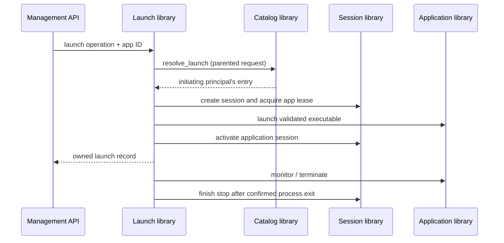

# Architecture and implementation boundaries

Amaterasu is a stable shell with managed, independently released libraries. This
replaces the earlier proposed architecture that put session policy and management
features in the core.

## Shell and runtime

The shell is responsible for bootstrap verification, loading, lifecycle calls,
and activation recovery. The separately loaded communication runtime owns request
routing, event delivery, hooks, endpoint identity, and grant enforcement. Its C
bootstrap ABI is independent of the versioned control-message contracts.

Product libraries own session coordination, configuration/state, authentication,
APIs, updates, diagnostics, platform brokers, and streaming features. The current
implementation includes separate state, configuration, session, catalog,
application, diagnostics, Steam discovery, authentication, and management HTTP libraries.
The command-line probe and local publisher establish the foundation; they are
not installed services or a replacement for the remaining product libraries.

The development `serve` command continuously supervises the same managed
libraries and ticks them between console requests. HTTP ingress is owned by the
management library, defaults disabled, and currently permits only explicit
loopback bindings. It authorizes exact route scopes through authentication before
dispatching product requests. Human-facing bearer identity does not become a
forged runtime principal: HTTP operations use the management library's namespace.
Remote TLS, installed service policy and multi-user namespace delegation remain
separate production requirements.

In the code, `Broker` dispatches to `RequestRouter`, `EventBus`, and `HookRegistry`.
The unsafe runtime boundary lives in `ffi.rs`. Rust feature modules implement
`ManagedModule` and use `RuntimeClient`; shared SDK adapters provide panic
containment and allocation ownership at the native boundary.

A component release can contain a library, helper executables, and private
native dependencies. The development package format currently admits one runtime
and native feature libraries. Packaging helpers, defining production dependency
closures, and media interfaces remain future work.

## Trust and permissions

The default verifier requires a project-key Ed25519 signature over the exact
manifest bytes and checks SHA-256 hashes and lengths of each artifact before
loading any library. It validates project/target, metadata expiry, ABI major,
component identity, exact selected dependency versions, and acyclic initialization
dependencies. Package requirements
are currently exact versions rather than a general version-range solver.

Requested grants are intersected with installed policy. There are separate grants
for providing/calling services, publishing/subscribing to events, and hooks.
Endpoint identity comes from the runtime rather than message fields. Delegation
using a parent request narrows authority and deadlines to the initiating call.
A trusted provider can also make direct requests under its own explicit grants;
this implementation does not claim to sandbox native providers or their syscalls.

Unsigned mode is off by default and read at process startup. Development packages
without signatures require the mode and custom component identities; invalid or
unknown signatures are rejected even in this mode. Unsigned code has the process's
privileges. A future administrator-only installed setting requires service and OS
permission integration that is not implemented yet.

Development roots are intended for a single trusted local user. Unix directories
and bootstrap records receive restrictive modes, but this is not a hardened
system installer. Windows ACL provisioning, secure parent-directory traversal,
load-time replacement resistance against hostile writers, and complete native
transitive dependency verification remain release blockers.

## Activation

The local publisher stages verified copies in content-addressed version
directories. It verifies the copied bytes before publishing the directory and
writes the pending selection through a synced replacement record. An OS file lock
serializes staging and host probes.

The supervisor records an activation trial before loading it in a separate
process. Health probing is separate from caller operations, so a failed activation
cannot replay a user's mutations against the fallback. A successful probe promotes
the set; a crash, failure, or five seconds without validated startup progress
retains the known-good set. Progress is ordered and bounded by the verified
component count, so repeated or out-of-phase worker output cannot extend the
watchdog indefinitely. A trial interrupted by supervisor
termination is discarded on the next start instead of retrying indefinitely.

Historical selection is explicit and does not reduce the highest accepted release
sequence. Expired metadata remains rejected. This is a development mechanism:
production signed historical catalogs and data-snapshot compatibility are not
implemented. No package migrations run yet.

Production trust rotation/revocation, online discovery, automatic idle activation,
long-running service health, supervisor replacement, and driver installation still
need implementation. The current Ed25519 manifest format is not represented as a
complete TUF-style secure update system.

## Planned product libraries

- Session coordination and resource leases; state/configuration and migrations;
  identity/authorization; management API; update manager; diagnostics.
- Platform session/privilege brokers; WGC/DXGI/PipeWire/DRM capture; NVIDIA/AMD/Intel
  encoders; media processing and HDR; audio; keyboard/mouse and controller backends.
- Display topology and recovery, with separate user-mode virtual-display adapters.
- Application lifecycle, library catalog, Steam/Playnite/Lutris providers, and
  game-activity detection.
- RTSS, NVIDIA settings, Lossless Scaling, and Linux performance providers.
- Independent TypeScript web bundle and its asset service.

Display recovery stays with display policy initially. Driver code is outside the
Rust user-mode rewrite; driver updates use installation machinery. A driver change
does not inherently require a new shell.

## Implementation order

1. Stabilize the tested development loader, SDK, control runtime, and local package
   transaction. Complete schemas, interface negotiation, and production trust design.
2. Extend the implemented state/configuration/session foundations and build identity,
   platform broker, and managed update libraries.
3. Validate real Windows/Linux capture-to-encode paths before freezing media ABI.
4. Complete display ownership/recovery, applications/providers, browser streaming,
   input/audio coverage, integrations, and frontend workflows.
5. Complete migration, production release handling, driver packaging, and hardware
   parity qualification. Track every omission in the parity ledger.

## Catalog launch ownership

The managed launch library owns the workflow connecting a catalog entry to a
session lease and an application process. The shell has no launch-specific code.

The runtime binds the initiator throughout parented requests. Catalog policy
explicitly permits the launch library's specialized lookup; normal catalog
operations stay scoped to their immediate caller. Payloads cannot select an owner
or replace the executable in a catalog launch request.

Cancellation can obscure a successful downstream mutation. Cleanup looks up the
launch library's own operation/session keys and runs under that library's existing
grants, without a cancelled parent. It never retries by creating another process.
An unconfirmed termination retains the session lease and reports unresolved cleanup.
An active application session does not imply that media streaming has started.

Native input and temporary virtual-display ownership currently have independent
provider leases. Connecting those resources to streaming session negotiation and
crash recovery remains explicit work; they are not implicitly acquired by an
application launch.
