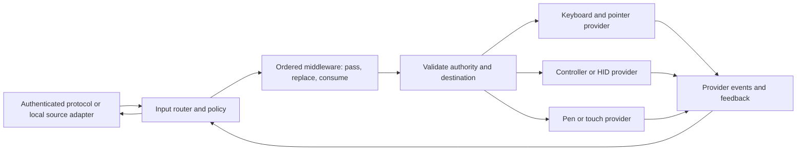

# Input provider SDK proposal

Research date: 2026-10-30. Status: design proposal, not an implemented API.

Six sequential review/revision cycles are complete; the record at the end names
the decisions made in each cycle. This is a reviewed conceptual contract, not a
frozen binary ABI or a claim that its platform guarantees have been implemented.

This repeats the competitor scope from the chat **Design the SDK encode API**
(`01a18f09-fd18-7572-99b9-941d8fbfe510`) for input. Eight Terra High agents
surveyed the external implementations and Amaterasu. All external findings below
are source observations at pinned revisions; no drivers, games, client devices,
or isolation boundaries were exercised. The recommendations are design inferences.

The recommendation is a bidirectional input SDK supporting both composition
with Amaterasu's built-in input and complete replacement of the input service.
Plugins may extend an existing stack, replace selected device providers, or own
the entire input implementation. These are equally supported integration modes.
Keep authorization, routing, state ownership, cleanup, and capability negotiation
available as reusable helpers. Let implementations own their native drivers,
operating-system APIs, threads, and device-specific behavior. Adding a capability
should not require replacing the entire service or editing a central enum;
choosing complete replacement must remain possible through public contracts.

## Survey and the requirements it reveals

The default-branch revisions were checked during this survey. Polaris advanced
from the encoder survey's `768c839c` to `de8d152d`; the other listed revisions
match the earlier survey. Punktfunk is evidence from its GitHub mirror; freshness
against its original upstream remains unverified.

| Project and inspected revision | Concrete source behavior | Requirement for the common SDK |
| --- | --- | --- |
| Rubylight `70f02f6c832c765093bfb00017aa0deb37171fef` | [Typed input and guarded coalescing](https://github.com/RamazanKara/Rubylight/blob/70f02f6c832c765093bfb00017aa0deb37171fef/rust/core/src/input.rs#L341-L519); [session/role-scoped controller pool](https://github.com/RamazanKara/Rubylight/blob/70f02f6c832c765093bfb00017aa0deb37171fef/rust/host/src/controller_sessions.rs#L16-L90); [DualSense waveform route and fallback](https://github.com/RamazanKara/Rubylight/blob/70f02f6c832c765093bfb00017aa0deb37171fef/rust/windows/src/input/gamepads.rs#L301-L337). | Event-specific ordering rules, stable logical identity across bounded reconnects, and explicit effective feedback capabilities. |
| Umbra `4975fb3f5c723628fb995f3f6aa4ef23bb35bcc7` and Eclipse `21ede3e308dbc50090dc101c56d2eb24b889e70e` | [Host controller IDs differ from client slots](https://github.com/PreceptorOfMagic/Umbra/blob/4975fb3f5c723628fb995f3f6aa4ef23bb35bcc7/src/input.cpp#L837-L869). Eclipse [maps controllers separately for each host](https://github.com/PreceptorOfMagic/Eclipse/blob/21ede3e308dbc50090dc101c56d2eb24b889e70e/src/app/stream/input/coop_gamepad_map.c#L3-L49) and [maps composite panes and pins dragging](https://github.com/PreceptorOfMagic/Eclipse/blob/21ede3e308dbc50090dc101c56d2eb24b889e70e/src/app/stream/input/coop_pointer.c#L258-L345). | Separate source identity, client slot, destination, virtual device, and reverse feedback route. Explicit coordinate transforms and ownership during route changes. Co-op across hosts is not proof of OS multiseat isolation. |
| Punktfunk `bd072336f79cd75d392c2ce6d314a4a2309a7fae` | [Sequenced controller snapshots and edge delivery](https://github.com/punktfunk/punktfunk/blob/bd072336f79cd75d392c2ce6d314a4a2309a7fae/crates/core/punktfunk-core/src/client/pump/input_task.rs#L1-L80); [extended contacts, motion, and raw controller reports](https://github.com/punktfunk/punktfunk/blob/bd072336f79cd75d392c2ce6d314a4a2309a7fae/crates/core/punktfunk-core/src/quic/datagram.rs#L289-L350); [bounded pen history and stale release](https://github.com/punktfunk/punktfunk/blob/bd072336f79cd75d392c2ce6d314a4a2309a7fae/crates/core/punktfunk-core/src/quic/pen.rs#L1-L85). | State reconciliation distinct from edge events; sample timing/history; optional device-specific report schemas rather than a permanently closed gamepad model. |
| LuminalShine `dba21a9ef69222b40a18227c2783853b954dfdf7` | [Multiple VHF controller profiles](https://github.com/NortheBridge/luminalshine/blob/dba21a9ef69222b40a18227c2783853b954dfdf7/src/platform/windows/vhf_gamepad.cpp#L123-L192), [controller metadata and motion](https://github.com/NortheBridge/luminalshine/blob/dba21a9ef69222b40a18227c2783853b954dfdf7/src/platform/windows/vhf_gamepad.cpp#L270-L395), and [feedback/lifecycle work](https://github.com/NortheBridge/luminalshine/blob/dba21a9ef69222b40a18227c2783853b954dfdf7/src/platform/windows/vhf_gamepad.cpp#L602-L846). | Discoverable profiles, actual availability checks, typed feedback, and instance generations during driver recovery. |
| Foundation Sunshine `bcbb5ec76afc27964b04142eeded465bf61d6a49` | [Precision-touchpad contact frames](https://github.com/AlkaidLab/foundation-sunshine/blob/bcbb5ec76afc27964b04142eeded465bf61d6a49/src/input.cpp#L1320-L1372) and [repeat/cancellation](https://github.com/AlkaidLab/foundation-sunshine/blob/bcbb5ec76afc27964b04142eeded465bf61d6a49/src/platform/windows/input.cpp#L1395-L1432); [DS5 sidecar haptic PCM and control](https://github.com/AlkaidLab/foundation-sunshine/blob/bcbb5ec76afc27964b04142eeded465bf61d6a49/tools/sunshine-ds5-sidecar/ControllerSession.cs#L260-L387). | Precision touchpad is a separate device/surface contract from touchscreen and controller touchpad. Sampled haptics needs stream identity, format, timing, and start/end semantics. |
| MoonlightWeb `284326e6ef3eacdcd562ed3e31a2af9c2fa0c751` | [Ordinary input channel](https://github.com/linckosz/moonlight-web/blob/284326e6ef3eacdcd562ed3e31a2af9c2fa0c751/frontend/js/api/WebRtcDataChannel.js#L512-L543), [separate WebHID delivery contract](https://github.com/linckosz/moonlight-web/blob/284326e6ef3eacdcd562ed3e31a2af9c2fa0c751/frontend/js/hid/hidWire.js#L11-L24), [held-state heartbeat](https://github.com/linckosz/moonlight-web/blob/284326e6ef3eacdcd562ed3e31a2af9c2fa0c751/frontend/js/ui/StreamView.js#L1606-L1640), and [watchdog neutralization](https://github.com/linckosz/moonlight-web/blob/284326e6ef3eacdcd562ed3e31a2af9c2fa0c751/backend/src/streaming/InputWatchdog.cpp#L137-L215). | Transport-neutral ingress, per-class delivery semantics, focus/disconnect reconciliation, and optional HID transactions. Its ordinary browser touch path emulates a mouse; it does not establish native pen/touch parity. |
| Polaris `de8d152de13a7351f8e903a3a3d7dd11ac374b9e` | [Seat and generation validation](https://github.com/papi-ux/polaris/blob/de8d152de13a7351f8e903a3a3d7dd11ac374b9e/src/platform/linux/multiseat_input_authority.cpp#L350-L394); [Wayland/libei/uinput routing](https://github.com/papi-ux/polaris/blob/de8d152de13a7351f8e903a3a3d7dd11ac374b9e/src/platform/linux/input/inputtino_mouse.cpp#L20-L54); [blocking host fallback for isolated input](https://github.com/papi-ux/polaris/blob/de8d152de13a7351f8e903a3a3d7dd11ac374b9e/src/platform/linux/input/inputtino_ei_virtual_input.cpp#L548-L562). | Authorized destination handles and explicit isolation/fallback outcomes. A working host-wide injector is not a valid substitute for a required isolated seat. |
| Hermes `2fa4e26f1fc4c899af820c129d4c204231f5bc25` | [Session-tagged virtual devices and permission failures](https://github.com/MrOz59/Hermes/blob/2fa4e26f1fc4c899af820c129d4c204231f5bc25/src/platform/linux/input/inputtino_common.h#L52-L111); [DS5 feedback](https://github.com/MrOz59/Hermes/blob/2fa4e26f1fc4c899af820c129d4c204231f5bc25/src/platform/linux/input/inputtino_gamepad.cpp#L119-L179). | Separate device creation from successful exposure to the intended application; per-device controller capabilities and feedback routing. |
| Sunshine `2c8825ad5b66cf9750f8154691202f0cd8768ac0` | [ViGEm feedback and motion enablement](https://github.com/LizardByte/Sunshine/blob/2c8825ad5b66cf9750f8154691202f0cd8768ac0/src/platform/windows/input.cpp#L280-L337), [key/button cleanup](https://github.com/LizardByte/Sunshine/blob/2c8825ad5b66cf9750f8154691202f0cd8768ac0/src/input.cpp#L2272-L2335). | Preserve established keyboard/mouse/controller behavior and cleanup while exposing providers. Inherited fork behavior is not counted as a distinct innovation. |
| Wolf `9f439311dd7b93a5f35e14c578ff4385d666d758` | [Session-owned controllers and feedback](https://github.com/games-on-whales/wolf/blob/9f439311dd7b93a5f35e14c578ff4385d666d758/src/moonlight-server/control/input_handler.cpp#L20-L208); [lobby reassignment](https://github.com/games-on-whales/wolf/blob/9f439311dd7b93a5f35e14c578ff4385d666d758/src/moonlight-server/sessions/lobbies.cpp#L190-L239); [ordered device exposure and udev notification](https://github.com/games-on-whales/wolf/blob/9f439311dd7b93a5f35e14c578ff4385d666d758/docs/modules/dev/pages/fake-udev.adoc#L58-L78). | Destination routing can change independently of remote identity. Device creation/exposure/removal needs an explicit lifecycle and optional deployment adapter. |

The table does not mean every listed project supports every input family. Examples
of limits matter: Eclipse's co-op feedback interface exposes rumble and trigger
rumble, not every host feedback kind; Polaris's isolated backend has different
capabilities from its ordinary DS5 route; Wolf and the inspected Linux fork touch
paths have unfinished cancellation cases. These omissions motivate conformance
tests rather than behavior to reproduce.

## Amaterasu's starting point

The local source was inspected on `main` at base commit
`598e1674edb310449b66fdb5e762e89735c946b8`, with concurrent uncommitted work present.
Local links describe the inspected working tree, not a clean release snapshot.

- [The module](../modules/input/src/lib.rs) already provides an independently
  loadable `amaterasu.input/1` service. Its `backend` and `model` modules are
  private. The [backend trait](../modules/input/src/backend/mod.rs) is selected by
  target platform and contains concrete DS4/DS5 settings. Publishing that trait
  unchanged would expose internal policy and freeze today's device vocabulary.
- [The model](../modules/input/src/model.rs) has bounded batches, lease operations,
  keyboard/pointer/controller/pen/touch events, and feedback operations. The
  [profile enum](../modules/input/src/gamepad_profile.rs) is closed. There is no
  public input provider module alongside capture/encode in the
  [module SDK](../crates/module-sdk/src/lib.rs), nor an input-specific C header.
- [The controller](../modules/input/src/controller.rs) owns one exclusive lease,
  authenticates both caller and token, records held state, gates policy changes,
  and retains failed cleanup for retry. Replacing `Option<Lease>` with a map alone
  would not make shared desktop input correct.
- [Protocol decoding and translation](../crates/gamestream/src/control/README.md)
  already distinguish many wire events. Decoding text does not mean it can be
  injected: the generic translator rejects it. Native pen/touch has separate
  policy, backend, and verified geometry gates. The generic SDK must not advertise
  features solely because a decoder or event type exists.
- [Feedback](../modules/input/src/feedback.rs) already has a bounded,
  generation-scoped queue, coalescing, PCM gating, and peek/ack. Its payload and
  validation depend directly on GameStream `HostFeedback`. The
  [stream-session adapter](../modules/stream-session/src/pipeline/input.rs) has
  both this path and a distinct companion-rumble path with expiry/terminal-zero
  handling. Typed feedback polling is currently scheduled at 20 ms; companion
  rumble polling at 40 ms. These intervals are not measured end-to-end latency.
- [Companion authorization](../crates/input-companion/src/linux_service.rs)
  verifies host permits, component identity/digest and peer process/session, and
  cleans up on disconnect/revocation. Provider discovery must preserve these
  checks. Native modules remain trusted code; API grants are not a sandbox.

Current backend implementation and qualification limits remain documented in
[the input README](../modules/input/README.md). In particular, recognized Windows
VHF profile names do not establish working VHF gamepad creation; Linux profile
support differs by device; PCM depends on the selected path and client capability.
This proposal does not close those native implementation gaps by renaming them.

## Component boundaries

The diagram shows the default composition, not a mandatory internal architecture.
`amaterasu.input` is the default product coordinator. It owns leases, routing,
state reconciliation, remap ownership, limits, and teardown within host-issued
grants. An independent service may replace that coordinator and use its own
internal architecture while honoring the public input-service contract and
host authority. The shell continues to load generic services and native interfaces.

### Supported integration modes

| Mode | What a plugin owns | What can remain built in |
| --- | --- | --- |
| Stack an extension | A configured transformation, additional event source, feedback transformation, or negotiated device feature. | The coordinator, native devices, ordinary event handling, and other extensions. |
| Replace selected providers | Specific device classes, profiles, or authorized destinations, including composite devices. | The coordinator and every unselected provider or stage. |
| Replace the complete service | The input coordinator and its implementation, optionally reusing SDK helpers or built-in provider services. | Streaming consumers, protocol adapters, host grants, and public service/lifecycle contracts. |

Make both service selection and provider/stage composition explicit in trusted
configuration. Consumers bind the selected input service through a configured
alias and compatible version, rather than requiring the built-in component name.
A replacement may register its own service identity with the necessary grants;
it does not need to impersonate `amaterasu.input`. Helpers are optional, but
external authorization, capability, ownership, feedback and teardown guarantees
remain part of the contract. A replacement is not required to run built-in stages.

Define a versioned service-facing contract independently from the provider ABI.
The migration must replace existing hardcoded service binding in consumers once
and preserve acquire/lookup/renew/batch/release, errors, partial-batch results and
both legacy feedback operations through a compatibility adapter. "Unchanged
consumers" then means those migrated consumers work with either the built-in or
a separately named compatible replacement. A configured alias alone is not wire
compatibility. The selected service reports the effective configured middleware
chain; if required stages cannot be honored, opening fails. An explicitly chosen
standalone replacement may run without stages when configuration requires none.

Legacy acquire/lookup has an operation identity; legacy `Batch { lease, events }`
does not. Only operations with a real identity can map to retryable receipts.
Never deduplicate legacy batches by equal payload: identical deltas or taps can
be intentional. An ambiguous lost legacy batch reply retains the existing
fail/cleanup behavior. Retryable batches require migrating their producer to a
new versioned request carrying a stable identity. The adapter cannot manufacture
cross-retry identity for a message that never supplied one.

### Middleware and stacking contract

Expose ordered, scoped stages on the input path and a separately configured
feedback path. A plugin can transform controller motion before the built-in
controller provider, add a controller profile alongside existing profiles, or
process haptic feedback while retaining ordinary keyboard/mouse input. Selection
may be scoped by device, event family, negotiated capability and destination.
Unselected events retain their configured built-in route.

Stages declare required input schemas, produced schemas, compatible capabilities,
ordering, and bounded expansion. Resolve and validate an acyclic stack before
opening it. Reject conflicting exclusive handlers unless configuration provides
an explicit owner; registration order must not silently decide precedence.
Negotiate effective capabilities across the selected path, rather than assuming
the union of every plugin's advertised features is usable.

Each middleware stage returns one explicit propagation decision:

| Result | Coordinator behavior |
| --- | --- |
| `Pass` | Send the original event to the next stage. The stage has not injected it or claimed external handling of it. |
| `Replace(events)` | Replace the original with a nonempty, bounded, ordered list of derived events. Resume each at the next stage; do not also forward the original. |
| `Consume` | Stop propagation for this event. In the first-version middleware contract this is intentional suppression; no downstream stage or default sink receives it. Native handling uses a terminal provider and its separate delivery receipt. |

Use `Consume` instead of an empty replacement list. Ordered batches and derived
events retain authenticated source identity and provenance; derived events have
their own identities linked to the original. Validate replacement payloads and
authority before admitting them downstream. A middleware decision does not grant
permission to inject input or perform another action.

For the synchronous C ABI the coordinator supplies a bounded output arena and
event-descriptor array with explicit capacities. Replacement payloads are written
into that arena and described by checked offsets/lengths; no returned pointer may
refer to plugin stack storage or a plugin-owned allocation. Input and output
storage are borrowed only for the callback, cannot alias, and cannot be retained
or accessed afterward by the plugin. The coordinator validates lengths, alignment,
schemas and counts before committing output. Declared maximum output is reserved
before invocation; exceeding it is a terminal stage error, not an invitation to
retry a stateful callback with a larger buffer. Rust adapters write into this
same contract without exposing Rust layout or crossing allocator ownership.

The coordinator drives the chain. Plugins return decisions rather than receiving
an unrestricted `next()` callback. Replacement events start after the producing
stage, never implicitly reenter that stage or restart the chain. Enforce declared
per-stage and total expansion/work limits so several individually bounded stages
cannot create unbounded work together. Native injection belongs to an explicit
terminal handler, either built in or supplied by a plugin; ordinary middleware
does not inject and then pass the same event onward.

For example, a shortcut stage can consume a recognized button combination, a
remapping stage can replace a key, and a gyro stage can emit pointer deltas.
Unclaimed events reach the selected native provider unchanged. The first version
supports synchronous stateful mapping/suppression, including shortcuts based on
already observed held state. It cannot retract a modifier that already passed.
Deferred chord recognition, timed macros, asynchronous middleware and externally
side-effecting actions are follow-on interfaces, unavailable until they define
bounded scheduling, emission, receipts, ordering and cancellation. `Consume`
does not authorize retaining an event for a future timeout flush.

Propagation and execution status are separate. First-version middleware returns
a synchronous decision or a terminal stage error, never `Busy` or `Pending` after
invocation. Before invoking any stage the coordinator reserves input storage,
the configured worst-case bounded derived work, ownership records, decision
storage and completion capacity. Insufficient capacity returns busy before any
stage invocation or source-state mutation. The ingress receipt is installed
before calling the stage. On valid return, record its decision and derived
ownership before dispatching downstream; the stage may update its private state
once during this invocation. There is no rollback/retry of a mutating stage.

A stage error, invalid output or lost response after invocation fails the route
and requires reset/cleanup, even if no native effect is known. Retain the decision
and downstream progress so a busy terminal provider retries only unaccepted
output, never the middleware or already admitted replacements. Native providers
may report accepted-pending, partial failure or unknown execution; none means
"try another plugin." In-memory receipts do not promise atomic persistence
across process death. Unknown results quarantine the route rather than replaying
it. External actions need a separately negotiated idempotent action interface;
ordinary middleware cannot perform an action and then return `Pass` or `Consume`.

Admission is one serialized route transition: verify generation, deduplicate the
submission identity and payload, reserve capacity, assign route order, and install
the receipt before updating source state or invoking middleware. A concurrent
duplicate observes that receipt; reusing its identity for different content is
an error. Reset fences this same transition. Calls into plugins run outside the
admission lock, under a tracked invocation token; reset must retire that token
and all accepted work before cleanup can complete. No old-generation result is
dispatched after the fence. If admission fails, none of these state changes occur.

Pin the chain and its state ownership for each active device/gesture. Matching
key-up, contact cancellation, and feedback stop must reach the owner of the
original action, even after configuration changes. Disabling or unloading a
stateful stage requires draining/releasing its derived state; it cannot simply
be bypassed. An optional stage may be skipped only under a pre-negotiated bypass
contract that leaves no owned state or uncertain work. Failure stays scoped to
the affected route when ownership permits unrelated routes to continue.

The SDK keeps the disposition of each press/contact: whether it passed through,
which replacements it produced, or which stage consumed it. A remapped key-down
keeps the corresponding key-up mapping. A consumed key-down keeps its release
associated with the consuming stage and does not leak an unmatched release to
the default sink. If a down already reached a native sink, later middleware may
not swallow its up while leaving that native state held: deliver the recorded
release or complete explicit neutralization first. Consuming an event stops its
future propagation; it does not undo an earlier event or cancel native work that
was already accepted. Cleanup follows the recorded ownership path independently
of ordinary middleware consumption.

Track an ownership graph from the original control/press through every derived
event and stage-local disposition to the final native leaves. For A→(B,D) then
B→C, releasing A closes C and D, and informs both stages of their corresponding
state transition. Release/reset traverses each owned edge once; later middleware
cannot replace or consume away an existing leaf's release obligation. Shared
leaves use owner counts. A partially delivered replacement records which leaves
are accepted, pending or indeterminate, so cleanup covers actual/possible native
effects without injecting outputs that never reached a sink. Generation changes
do not discard this graph before its releases or endpoint reset are confirmed.

Stacking several features on one virtual device does not create several native
writers. The device owner serializes the final report. Extensions contribute
through negotiated event/feature interfaces it supports; unsupported combinations
fail explicitly. Cross-plugin device sharing requires that contract, not access
to another plugin's private driver handle. Full-service replacements may also
compose these same stages and providers, without being forced to do so.

An injection provider owns the native endpoint and reports its capabilities,
delivery results, device changes, and feedback. A session may choose different
providers by device class: for example libei pointer/keyboard and UHID controllers.
One provider may offer a composite endpoint when its device needs several
interfaces. Each destination device has one authoritative injection route;
fan-out is an explicit coordinator policy, never accidental duplicate delivery.

A source adapter translates authenticated client protocol or a separately
authorized local producer into common events. Moonlight/WebRTC/QUIC packet
formats, channel numbers, encryption, and client feature negotiation stay in
these adapters. A source cannot select a native device path or create a lease
by supplying an ID in an event.

An optional transform implements reusable remapping, accessibility controls,
gyro-to-pointer, or touch-to-pointer conversion. It consumes and emits bounded
typed events, declares its required capabilities and expansion limit, and owns
no OS injection. The coordinator validates output authority again. Stateful
transforms retain the down-to-up mapping, flush owned state on reset, and cannot
silently swallow cleanup. Begin with a fixed, acyclic configured chain; arbitrary
hooks into another provider's internals are unnecessary.

The router records the post-transform held state and each original down's native
destination plan. Filter instances are per lease, with bounded nonblocking work;
failure or removal closes admission and releases that derived state. Do not
bypass a failed filter while keys are held. Shared destination keys still need
owner counts when several source keys map to one key.

### Snapshot projection and policy ownership

Keep source state separate from the effective state owned at each stage and
destination. A full controller/held-state snapshot updates the source ledger
under its sequence watermark, then reconciles through the pinned dispositions.
It never goes directly to a native sink. A consumed A remains suppressed in
subsequent snapshots while held; an A mapped to B keeps B's ownership until A is
released. Other buttons and axes in the same report continue independently.
Missing releases cancel recorded derived ownership. Reconciliation restores
declared held state without replaying a one-shot shortcut, text, tap or delta.
Snapshot-aware stateful stages must supply an explicit reconciliation operation;
a stage without it cannot negotiate a route requiring state recovery.

The reconciliation operation receives recovery context, the source-state delta,
and existing ownership, and returns a bounded state-only projection plus ownership
changes. When a snapshot first reveals an unseen held control, each stage computes
and records a new recovery disposition instead of replaying its normal press
callback. It may restore a held remapping or suppress it; it must not trigger a
one-shot shortcut, repeat, text, tap or external action. The eventual release
uses that recorded disposition. A stage unable to recover explicitly rejects
reconciliation, forcing neutralization and a new source epoch/fresh state before
reopening. Existing consumed/remapped controls keep their pinned disposition.
Recovery uses the same serialized admission, bounded storage and cleanup rules
as normal input. A later snapshot cannot bypass a stage that rejected recovery.

The first-version recovery algorithm uses a serialized snapshot barrier, not a
per-control merge. Each snapshot declares its complete authoritative scope,
source epoch and comparable sequence watermark. If its watermark precedes any
already-admitted source-state change in that scope, reject the entire snapshot
as stale without changing source or projected state. Reject old epochs likewise;
an equal watermark must agree with already known state or is a protocol conflict.
Serialize admissible snapshots with normal input and update their watermark in
the same admission transition. A snapshot at W=10 cannot release a down at 11
or resurrect a control released at 11. Schemas define omitted controls as neutral
only inside the declared complete scope; other device families are unaffected.
Adapters must establish the required ordering and epoch boundary, not substitute
local receipt time for unknown source order. If they cannot, recovery is
unavailable; neutralize/fence the source and obtain a fresh trustworthy baseline
or close the source session. Old queued packets cannot be relabeled as new-epoch
input merely because the coordinator reset its counters.

Define one owner for each policy operation: source normalization, configured
remapping/repeat/scroll policy, and final native encoding are separate steps.
The built-in adapter initially wraps existing policy as one explicit stage, or
moves it into the coordinator and uses policy-free native adapters. It must not
run both. Profiles still own native report layout; policy scope and order are
part of the pinned route. Test plugin mapping plus existing keybindings,
Right-Alt mapping, repeat generation and fractional scroll on all supported
backend routes before claiming compatibility.

The initial scheduler serializes dependent work within a route, including key
and pointer events that share stage state or target ownership. Later events do
not overtake an unresolved earlier decision or native admission barrier.
Independent routes may progress fairly only when they share no ordering/state
dependency. No synchronous callback may wait for future input or remote I/O;
deadline violations fail the affected route and still require actual callback
retirement before unloading. A configured time budget is not preemption of a
hung trusted native plugin. Deferred scheduling requires an optional extension.

## Proposed public contracts

### Registration, negotiation, and identities

Use configured provider aliases mapped to signed versioned services and the
existing call/native grants. Discover profile IDs as namespaced strings with
schema versions; preserve current `xone`, `ds4`, and other settings through an
adapter. An unrecognized required profile fails explicitly. A preferred profile
can use only an authorized fallback, returning the selected profile and reason.

Reject duplicate aliases. Pin resolved service identity, interface version and
configuration identity for the lease; registry changes apply to a subsequent
lease or an explicit coordinated transition. A successful probe is not a promise
that a later open will still succeed.

Negotiate a complete route: event families, key encodings, device profile,
target/seat, native versus emulated delivery, contact/button/axis limits, motion
rates and units, feedback features, optional extensions, queue bounds, and actual
availability. Keep provider support, successful open, policy permission, and
remote-client support separate. Capabilities are per opened device and route,
with generations for changes; a single `controller_input: true` is insufficient.

The identity envelope distinguishes:

- Authenticated source/principal, session/lease, and their generation.
- Source-local device identity and optional protocol-relative controller slot.
- Host-local device instance and instance generation, independent of its index.
- Authorized destination/seat handle and destination generation.
- Surface/transform generation and event sequence within the source stream.

VID/PID, display name, OS node, and client slot are metadata or mappings, not
authorization or globally unique identity. Reconnect continuity is a bounded
policy decision tied to authenticated identity. Neutralize old state before
retaining or reattaching a virtual device; stale callbacks must not reach a new
owner occupying the same slot.

### Event vocabulary

| Family | Required distinctions |
| --- | --- |
| Keyboard | Physical key namespace/code versus logical key versus committed UTF-8 text; down/up/repeat; modifiers and layout information where meaningful. Full IME composition is a separately negotiated extension, not implied by committed text. |
| Pointer | Relative deltas versus absolute surface coordinates; button transitions; horizontal/vertical scroll with explicit units and fractional precision; raw/unaccelerated provenance where known. |
| Screen touch | Surface and contact identity; frame identity; down/move/up/cancel/cancel-all; pressure/contact geometry with presence flags and declared limits. |
| Pen | Tool/eraser, proximity/hover/contact phases, buttons, pressure/distance/tilt/rotation, optional oldest-first timestamped sample history. Unsupported fields must be reported rather than silently reinterpreted. |
| Precision touchpad | Full multi-contact frames, surface dimensions/physical units where available, contact IDs, click state, and cancellation. This is distinct from screen touch and controller touchpad reports. |
| Controller | Arrival/removal, advertised source properties, complete state and supported transitions, extensible buttons/axes, battery, motion, multiple named touch surfaces, and separately negotiated feedback. |
| State/lifecycle | Authoritative source state snapshot with sequence watermark, reset/revoke, device unavailable/recovered, capability changes, and observed delivery/cleanup results. |

Document units, ranges, axes, handedness, normalization, and unknown-value flags
for every standard schema. Motion adapters convert explicitly between protocol
degrees/s and an agreed common schema; raw sensor integers need scale/calibration
metadata or a device-specific schema. Zero is a real value, not a universal
stand-in for missing pressure, motion, battery, or geometry.

Coordinates use an `InputSurface` with source/reference dimensions and an
authoritative mapping to the target. Account for crop, letterboxing, display
offset, scaling, rotation, and composite panes. Do not make Windows 0–65535
desktop coordinates the universal model. Capture/display components supply
trusted geometry; clients supply their declared source coordinates. A topology
change invalidates old mappings. Reject or explicitly remap stale-generation
events, and preserve the original route for a held drag/contact until release
or cancellation. Never guess a host desktop when the requested seat disappears.

Each payload uses a standard schema or a negotiated namespace/version with
bounded length. Unknown required schemas fail. Optional unknown data can be
omitted only under the negotiated contract; an arbitrary byte blob is not a
device-control permission.

### Provider operations and delivery

The following are conceptual operation names, not final ABI declarations:

| Operation | Contract |
| --- | --- |
| `enumerate` / `probe` | Return supported profiles/routes and requirements. Describe whether a probe needs permission or temporary native resources; ordinary discovery must not create active input devices. |
| `open` | Given an authorized target and negotiated plan, return endpoint/device handles, generations, effective capabilities and lifecycle state. Deduplicate a retried open by operation identity. |
| `try_submit` | Borrow a bounded event batch. `busy` accepts nothing. Successful admission copies all data needed asynchronously and returns a receipt identifying accepted work. |
| `read_events` / `subscribe` | Deliver bounded progress, injection failure, capabilities, device lifecycle and feedback. Rejection retains nonreplaceable events for retry; notifications only announce available work. |
| `ack_events` | Acknowledge an already read event prefix by batch token and event identity after the consumer has reserved/copied it into its own bounded delivery state. Repeated acknowledgments are idempotent and cannot acknowledge unread or newer events. |
| `reconcile` / `reset` | Apply a source-state watermark or neutralize state owned by that source. Cancel repeat/contact/feedback timers and invalidate obsolete queued work. |
| `begin_close` / `close_status` | Stop admission, retire native work and callbacks, release held state/devices/exposure, and report terminal cleanup completion or retained cleanup failure. |

Queue admission can be atomic even when OS injection is not. A later failure
must identify a known delivered prefix or an indeterminate native result.
Neither result permits blindly replaying key downs or relative deltas. Stop the
affected route and reconcile/neutralize it while retaining cleanup ownership.
An injection acknowledgment means the native API accepted the operation at the
reported level; it does not prove that a game consumed it. Legacy synchronous
backends can return immediate results through the same contract.

Acceptance transfers responsibility for retiring accepted native work to the
provider; the coordinator retains the source ownership ledger and oversees
cleanup. An indeterminate result quarantines the affected endpoint until reset
or destruction confirms neutralization. This is not a universal exactly-once
guarantee. Preserve the existing batch adapter's accepted-prefix and
`partial_event_possible` behavior until the new receipt path is qualified.

Submission identities and receipts have bounded retention. A duplicate accepted
submission must not inject twice. Once a receipt expires, an ambiguous retry
requires reconciliation, not a guessed success. Receipt state, sequence epochs,
and overflow behavior need conformance tests before publishing the ABI.

Reserve per-route and aggregate in-flight count/byte limits before admission,
including nonreplaceable completions. Pending, indeterminate or cleanup-owned
records cannot expire or be evicted to accept more work. Consumers explicitly
acknowledge terminal completions. Receipt identities include producer, route epoch
and request sequence. Each producer admits a contiguous sequence; a busy result
does not consume its next number. Advance the acknowledgment watermark only
through a contiguous settled and acknowledged prefix. Keep bounded sparse
acknowledgments and every earlier pending record when later requests complete
first; apply backpressure if that gap fills. A watermark rejects retired IDs
without replay, while older still-pending retries return their original receipts.
Compatibility adapters translate only genuine legacy operation IDs into this
namespace with the same deduplication reservation. Retained unacknowledged terminal
results may expire only by closing/reconciling the affected route and advancing
its epoch; an old retry is then stale, not a new request. Cleanup has separately
reserved capacity. This bounds a long-running stream without losing ownership.

Contiguous admission never lets release N+1 overtake an unaccepted request N.
The producer keeps a bounded ordered backlog and retries N only until its
negotiated admission deadline. If it cannot retain that backlog, a release cannot
progress, or the deadline expires, it invokes out-of-band reset/revocation.
That operation uses reserved control capacity and no ordinary request sequence
or receipt slot. It fences the epoch, retires accepted work and neutralizes owned
state; both N and N+1 then become stale and cannot be replayed in the new epoch.
This is an explicit loss/reset outcome, not successful delivery of either event.
An up that is already next in sequence uses its reserved release capacity.

Held ownership has separate per-route and aggregate limits on controls, graph
nodes, native leaves and bytes. Those reservations survive receipt completion
and acknowledgment until release/reset is confirmed. Before invoking a stage,
reserve the worst-case new held ownership and a bounded release obligation for
every new leaf/edge, including callbacks and fan-out. Repeated held snapshots
reuse existing ownership rather than allocating new nodes. Matching ups and
cleanup consume the reserved release capacity, independent of ordinary work and
receipt saturation; they cannot require a new ownership allocation to free the
old one. If native progress or malformed releases prevent normal completion,
use the separate reset path and retain ownership until retirement is confirmed.
Do not free these reservations merely because the original down was delivered.

Reset is a barrier: close admission, fence the old generation, stop/cancel and
confirm retirement of all previously accepted native work, then neutralize its
owned state and confirm cleanup before reopening under a new generation. A
delayed accepted down must never execute after the final reset up. If a worker
or callback cannot be confirmed retired, retain `cleanup_pending` and quarantine
the endpoint; process exit or timeout alone is insufficient proof for shared
devices. Coordinator-owned ledgers survive individual stage failure. Loss of
the coordinator itself requires a qualified companion/OS ownership recovery
mechanism; otherwise replacement and lease reuse remain blocked until cleanup
can be established. No crash-safe restart is promised by the SDK alone.

Edge and lifecycle events preserve order. A pointer move cannot cross a button,
contact, route, or transform barrier when coalesced. Relative deltas may be summed
only with checked arithmetic and matching semantics; they cannot use a generic
latest-value mailbox. Complete controller snapshots and appropriate motion
samples may replace older ones under their schema's rules. Snapshot watermarks
prevent stale state from undoing a newer edge or resurrecting a removed device.
Historical pen samples remain ordered rather than collapsing to one endpoint.

Define sequence wrap/epoch transitions and whether omitted contacts in each
frame schema mean unchanged or released. State snapshots cannot recover lost
text, relative deltas, or a complete missed tap; report those gaps explicitly.
Distinguish capture, receive, and injection timestamps. A pen sample's relative
spacing is not evidence of synchronized host/client clocks or paced injection.

Bound event counts, bytes, per-source queues, and work per dispatch. Reserve a
separate reset/revocation path so normal queue saturation cannot prevent cleanup.
If an edge cannot be retained, report failure and resynchronize or terminate that
route; do not silently drop it. Timestamps identify their clock domain, sequence,
and optional sample spacing. Remote timestamps alone do not establish one-way
latency or scheduled native-injection deadlines.

Use wakeable ingress and feedback notifications, with a deadline for providers
that need repeat/refresh timers. Allow a provider-owned worker around blocking
native APIs. State thread-affinity and callback rules explicitly. A future
notification interface must actually wake the input dispatcher before claiming
to remove current polling delays; merely adding a callback type is insufficient.

### Feedback, sampled haptics, and device reports

Make standard feedback independent of GameStream wire definitions: rumble,
trigger rumble, LEDs, adaptive-trigger effects, sensor-enable/rate requests, and
device status. Preserve the source device/session mapping in both directions.
Negotiate each feature through provider, coordinator policy, transport, and
client support. Forwarding a command does not establish that the physical
controller applied it; expose a completion only when an endpoint can provide one.

Use separate bounded delivery classes for state/control and sampled haptics.
State updates may coalesce by device/property when legal; transactions and
terminal stop/cleanup must survive PCM pressure. Haptic streams carry format,
sample rate/channels, stream generation, sequence, timestamp/domain, duration,
start/end, and expiry. Drop stale PCM under an explicit policy instead of
replaying a latency backlog. TTL/watchdogs stop effects on loss or revocation.
Controller waveform audio is not ordinary system playback; integration with
audio providers must preserve its device destination and authority.

Within the control class distinguish level state, one-shot effects, and periodic
watchdog refreshes. A retry must not repeat a one-shot effect; identical refresh
writes cannot always be deduplicated. Punktfunk's
[HID output rules](https://github.com/punktfunk/punktfunk/blob/bd072336f79cd75d392c2ce6d314a4a2309a7fae/crates/host/pf-inject/src/inject/hidout_dedup.rs#L1-L53)
make that distinction concrete. "Reliable" here requires bounded backpressure,
acknowledgment and failure semantics; it does not promise infinite retention or
delivery after a disconnected client. Adapt both existing Amaterasu feedback
paths once, preserving expiry and terminal zeros without double-producing events.

The first-version feedback middleware transforms only negotiated level-state
schemas, such as rumble intensity, within the same device/destination. It uses
bounded pass/replace/consume decisions and an effective-effect ledger. Consuming
a new level update leaves the prior delivered level active; it is not an implicit
stop. Record the final target and active state after transformation. A terminal
stop, expiry or reset bypasses suppression and neutralizes that recorded target;
no stage may consume or transform it into a nonzero effect. Invalid stop handling
fails the effect route and invokes coordinator cleanup. Stops use reserved
capacity and the same retirement ordering as input reset. Until schema-specific
extensions are qualified, one-shot/raw-report/PCM feedback is pass-only and
cannot be generically remapped or consumed. Transport acceptance is not physical
playback acknowledgment. Receiver expiry/watchdog/fence support is negotiated;
an unmodified legacy client must not be credited with guarantees it lacks.

The feedback ledger distinguishes queued, accepted-pending, confirmed at the
negotiated delivery level, and indeterminate effects. Before admitting a nonzero
level, reserve its cleanup/stop capacity and record both the previous effective
state and the possible new effect/target. An ambiguous dispatch does not replace
that record with guessed success or failure. Fence and retire all accepted
pre-stop output before sending the final neutral level; otherwise a delayed
nonzero could arrive after the stop. Keep possible effect ownership through
uncertainty. If local dispatch retirement or transport ordering cannot be
confirmed, quarantine that output epoch and prohibit reusing its ambiguous live
endpoint. Do not claim physical neutralization from local queue retirement;
the reported cleanup level must state its evidence.

Negotiate feedback cleanup guarantees independently: local work retired,
transport ordered/closed, and receiver effect neutralization confirmed. In a
strict receiver-confirmed mode, missing qualified stop acknowledgment, expiry
or endpoint reset makes that mode unsupported; do not silently downgrade it.
The legacy adapter explicitly reports best-effort remote cleanup and retains
its existing terminal-zero attempt. A normal legacy close may release local
resources after local work has retired and transport teardown/order is known,
reporting `remote_unconfirmed` when the client provides no physical evidence.
Lack of physical acknowledgment alone does not hold an otherwise cleanly closed
local lease forever. A new isolated authenticated transport/session may open
under a fresh epoch when old packets cannot enter it, without claiming the old
physical effect was stopped. Reuse of the same ambiguous unversioned live
endpoint remains blocked until qualified ordering, fencing, endpoint reset or
expiry removes the ambiguity. Unknown local retirement always keeps cleanup
pending. These outcomes are part of effective capability/status reporting.

Provide an optional device-scoped report extension for compatible HID providers:
negotiated descriptor/profile identity, report type/ID/size, input/output reports,
and correlated feature GET/SET transactions with bounded results, timeouts and
cancellation. The target device must already be authorized. Some reports are
complete replaceable state; others are ordered commands. The schema declares
which. Do not expose arbitrary `/dev/hidraw` paths or driver IOCTL execution to
remote event producers. Raw controller support does not imply universal USB,
keyboard, or arbitrary peripheral passthrough.

Feature operations are asynchronous with bounded deadlines; do not block the
host dispatcher on a remote HID round trip. Report whether a feature response is
physical, cached, or synthesized, and advertise which modes a provider supports.
Punktfunk's [virtual Steam Controller feature handling](https://github.com/punktfunk/punktfunk/blob/bd072336f79cd75d392c2ce6d314a4a2309a7fae/crates/host/pf-inject/src/inject/linux/steam_controller2.rs#L78-L116)
uses local replies where a round trip is unsuitable. Generic correlated remote
GET/SET is a proposed SDK contract, not a claim that Punktfunk implements it.
Its raw report path is integrated for specific controllers, including
[physical report capture](https://github.com/punktfunk/punktfunk/blob/bd072336f79cd75d392c2ce6d314a4a2309a7fae/crates/client/pf-client-core/src/sc2_capture.rs#L330-L375);
that does not establish universal device support.

### Lifetime, seat exposure, and ABI rules

The coordinator issues an opaque authorized destination. Providers report
whether they opened that destination and whether isolation was established.
An isolated-seat requirement cannot silently fall back to host-wide injection.
An optional deployment/seat adapter handles exposing native devices to a process,
compositor or container: create, validate/expose, notify, then admit input. Reverse
that order during removal, retaining failed cleanup. One device can expose
multiple native interfaces. OS permissions and container setup remain deployment
responsibilities; do not copy another project's permissive device-mode policy.

Preserve today's exclusive lease as the default. Multiple isolated seats require
independent device ownership and verified destination binding. Shared-desktop
control additionally requires an explicit arbitration policy and owner counts
for merged keys/buttons: one client disconnecting must not release another
client's held key. Source, filter, provider and destination generations must
cover all delayed work and feedback.

Add versioned C tables with major/minor/size checks and safe Rust adapters.
Borrow event payloads only for the call, copy for asynchronous use, and keep
bindings alive until work and callbacks retire. Unsubscribe is a synchronous
callback lifetime barrier. Provider close must state which cleanup remains;
a timeout never proves native retirement or permits unloading live code.
No unwinding across the ABI; no implicit cross-thread safety for device handles.
Native modules are trusted; grants restrict API routing, not arbitrary native code.

Caller-owned bounded arenas/descriptor arrays also apply to synchronous native
enumeration, capability/status output, event reads and variable-length feedback;
the rule is not limited to middleware replacement. JSON service responses use
the existing host copy boundary, with explicit byte limits and no transfer of
allocator ownership. Producers copy borrowed input before asynchronous retention.
First-version subscriptions signal readiness only, carrying fixed bounded
identity/generation metadata; they do not transfer event or PCM payloads.

Readiness callbacks may record bounded metadata and wake the consumer executor.
They must not reenter the provider, read events, or call unsubscribe/close from
inside that subscription's callback. The consumer schedules those operations on
its control executor after the callback returns. Subscribe must expose an already
ready condition without a lost-wakeup race; unsubscribe prevents new callbacks
and waits for admitted callbacks to retire. The ABI will document permitted
callback threads and serialization explicitly, without implying all handles are
thread-safe. A hung callback still cannot be safely unloaded by timeout alone.

`read_events` is a non-destructive bounded read of complete records into caller
storage. It returns a stable batch token and ordered event identities. Too little
capacity returns the required bounded size (or a declared limit error), consumes
nothing and exposes no partial record. Once peeked, nonreplaceable records stay
stable for retry until `ack_events` commits the accepted prefix; later state
coalescing cannot mutate that prefix. The consumer reserves space before reading,
deduplicates returned identities, and acknowledges only after recording its own
bounded ownership of delivery. Ack retries cannot redeliver already accepted
output. Producer output capacity and peek retention are bounded; backpressure
never evicts unacknowledged nonreplaceable output. Deadline PCM may expire only
under its negotiated explicit drop semantics, without invalidating the identity
of a retained control/cleanup record. Unsubscribe fences notifications, while
close additionally retires event production and records still requiring cleanup.

Use independently drainable event lanes for completion/retirement/cleanup,
ordinary control feedback, and deadline samples. Each lane has its own bounded
capacity, batch token, cursor and acknowledgment prefix. Reserve producer and
consumer completion/cleanup capacity when accepting work; those records must
remain readable even when ordinary feedback and transport delivery storage are
full. No acknowledgment crosses lanes. Define semantic dependencies explicitly
(for example, a final stop waits for prior output retirement) rather than relying
on one global FIFO that can deadlock its own completion path.

Unread expired PCM may be dropped under its declared sequence-gap semantics.
After PCM has been included in a peek, expiry retains a bounded `Expired`
tombstone with the same identity and batch position until acknowledgment; only
the payload storage is released. Retry reports that tombstone and can acknowledge
it as dropped. An acknowledgment of the original identity is still valid if
expiry raced the consumer. A consumer that already copied the sample observes
its deadline independently and never replays it on retry. Nonreplaceable records
are unchanged. Per-lane prefixes and tombstones let PCM expire without blocking
or changing the identity/order of a terminal control record in another lane.

A reserved cleanup queue cannot unstick a blocked or crashed provider. Declare
an independently serviceable cancellation path or rely on a qualified OS/worker
device-ownership mechanism, and expose `cleanup_pending` when neither can confirm
release. Do not claim crash-safe cleanup from an SDK helper alone. Shared control
also needs explicit repeat/focus/contact/controller arbitration, beyond key
reference counts.

## Implementation sequence

The current `amaterasu.input/1` broker batch contract has Rust SDK helpers and
C constants for capability negotiation and partial results. Those incremental
additions do not implement the native provider, middleware or receipt APIs
proposed below.

| Increment | Task-owned areas and outcome | Acceptance gate |
| --- | --- | --- |
| 1. Publish the domain contract | New `crates/input-api`, `sdk/include/amaterasu_input.h`, and `crates/module-sdk/src/input/`; public replacement-service, provider and middleware contracts with `Pass` / `Replace(events)` / `Consume`, coordinator dispatch, schema validation, identities, capabilities, receipts, feedback, and optional queue/lifecycle helpers. Keep protocol serialization separate. | Rust/C layout checks, unknown-version/size tests, finite/bounded payload validation, independently compiled fixtures using public dependencies only. |
| 2. Compose built-ins and independent components | Refactor `modules/input` around provider/stage registries and reusable lease/router state. Migrate consumer service binding and the legacy compatibility adapter here so the input service is selectable. Adapt current native and companion backends; preserve saved profile names and explicit unsupported behavior. | Existing input and companion tests pass; an extension stacks with built-ins, selected providers coexist, and a separately named replacement service works with the same once-migrated consumers. |
| 3. Connect real ingress and feedback | Adapt `crates/gamestream` and `modules/stream-session` to the shared event types after service binding migration. Adapt both current feedback paths, preserving negotiated PCM and terminal-rumble behavior. Add wakeable scheduling and timing counters where supported. | Authorized launch-to-provider-to-feedback fixture with built-in and replacement services, including required middleware; no borrowed GameStream event types in provider public API; backpressure and disconnect cleanup verified. |
| 4. Add evidence-driven extensions | Precision-touchpad frames, pen history, report transactions, haptic stream metadata, and optional bounded transforms. Implement at least one external example of the additional contracts. | Feature combinations negotiate end to end; unsupported sources/sinks remain explicit. A declared schema alone is not recorded as parity. |
| 5. Qualify multiple destinations | Add seat/deployment adapters and source-scoped ownership before enabling concurrent seats or shared control. | Isolated-target tests plus actual platform qualification; no host fallback, cross-client release, stale callback, or slot-reuse feedback leakage. |

These increments change libraries and provider wiring, not the generic shell's
product behavior. Runtime wake support, if necessary, should be a generic runtime
facility. Keep compatibility with `amaterasu.input/1` while migrating consumers;
new native tables must not change existing ABI prefixes. No direct source copy
or line-by-line translation from the surveyed implementations is proposed.

The first implementation should deliver selectable input services, provider and
stage registration, injection and canonical feedback while preserving the
built-in service's existing exclusive lease. Demonstrate both stacking a simple
extension with built-ins and replacing the complete service. Advanced stateful
transforms, source-provider registration, precision touchpad, HID transactions
and multiple destinations can then ship as individually qualified optional
capabilities. Composition and full replacement are foundational contracts, not
mutually exclusive choices deferred to different SDK designs.

## Conformance fixtures and release gates

The foundational first-version gate covers fixtures 1, 2, 4, 7, 8, 10 and 11 for
the standard event/feedback families the route actually negotiates, plus explicit
unsupported results for unavailable families. Preserve the existing built-in and
legacy compatibility regression coverage. These fixtures must demonstrate both
composition and complete replacement, rather than only validating type layouts.

Advanced cases are capability gates, not prerequisites to shipping the core:
composite-pane routing in fixture 3, precision-touchpad/pen-history extensions in
5, HID transactions in 6, concurrent seats/shared control in 9, and sampled PCM
cases in 7 are required when advertising those capabilities. Basic absolute
coordinate validation and existing supported pen/touch/PCM behavior still retain
their own compatibility checks. Deferring a capability means reporting it as
unsupported, not passing its fixture by declaration. Deferred chords, timers and
external actions need their own later specifications and qualification fixtures.

1. Two independently named providers composed for one session: ordinary
   keyboard/pointer plus a custom controller profile, with no central enum edit.
2. A browser-like source: key edges, committed Unicode, fractional wheel input,
   focus loss, empty held-state snapshot, and reconnect with delayed old packets.
3. A composite-pane source: crop/letterbox/rotation transforms, a held drag during
   pane swap, missing geometry, and target-generation change.
4. A controller provider: arrival/removal, profile failure, slot reuse, multiple
   touch surfaces, motion units, battery, and correctly reverse-mapped feedback.
5. A precision touchpad and a pen-history provider: atomic contact frames,
   hover/pressure presence, ordered historical samples and cancel-all teardown.
6. A HID extension fixture: size/schema rejection, GET/SET correlation,
   side-effecting request deduplication, timeout/cancel, and late response after
   device removal. No physical HID access is needed for protocol tests.
7. A haptic provider under output pressure: sampled PCM expiry and stream restart,
   reliable state/control progress, terminal stop, capability denial, and both
   legacy feedback adapters. Race accepted-pending and indeterminate nonzero
   effects with stop/expiry; check both local retirement and receiver evidence.
   Cover a legacy client without stop ACK/fence, explicit strict-mode rejection,
   clean local close with `remote_unconfirmed`, and blocked ambiguous endpoint
   reuse. Expire PCM between peek and partial-prefix ack while a stop is pending.
8. Failure injection: queue saturation, partial native delivery, failed key-up,
   device destruction failure, permit revocation, provider crash, cleanup retry,
   unsubscribe races, and attempted unload with outstanding callbacks.
9. Seat and shared-control fixtures: target exposure failure, prohibited host
   fallback, two sources holding one key, one disconnecting, and delayed device
   callbacks from an earlier owner. Simulated tests establish state invariants;
   actual OS isolation and game input require separate platform qualification.
10. A stack extending built-in input: two ordered transformations, an independent
    feedback extension, unaffected pass-through traffic, conflicting handlers,
    unavailable required stages, backpressure without fallback duplication, and
    stage removal while a transformed key/contact remains held. Verify `Consume`
    prevents downstream delivery, replacements resume at the next stage without
    forwarding the original, and total expansion is bounded. Cover consumed
    down/up pairs, a passed down followed by an attempted consumed up, changed
    remappings during a hold, and receipt retries without repeating actions or
    replacements. Include snapshots after consumed/remapped controls, lost-up
    reconciliation, saturation before stage invocation, and delayed native work
    crossing reset. Deferred chord buffering is a later extension qualification.
    Include multi-stage fanout release, snapshot-discovered missing presses,
    concurrent identical admission/reset races, out-of-order completion/ack and
    older-pending retries, and feedback transforms attempting to consume a stop.
    Verify stale snapshots after newer down/up, lost legacy batch replies without
    payload deduplication, held-state exhaustion followed by release/reset, and a
    separately compiled C stage returning multiple arena-backed replacements.
    Include a C provider/service fixture with variable-sized event reads,
    insufficient output capacity, stable peek/ack retry and unsubscribe races.
    Saturate request N then submit up N+1 and verify out-of-band reset; fill
    producer/consumer feedback queues while completions and cleanup still drain.
11. An independently named complete input service: selected by configuration,
    using public SDK contracts with unchanged stream consumers; verify grants,
    capability negotiation, leases, input, feedback and cleanup. Exercise both
    its own implementation and optional reuse of a built-in provider.

For implementation, run focused tests, rustfmt, and Clippy in the owning changes.
Network tests use loopback and ephemeral ports by default. Keep source, fixture,
native-platform, and real-client/game qualification separately reported.

The completion criterion is practical: an author can stack a capability onto
built-in input, replace selected providers, or replace the entire input service
using public SDK contracts and configuration. They can reuse authorization,
ownership, cleanup, routing and feedback helpers without being required to adopt
the built-in implementation. A genuinely new interoperable event schema may
need standardization; a different driver or implementation should not.

## Design review record

The following are design review/revision cycles with two Terra High reviewers
per cycle. They are not implementation tests or hardware qualification.

| Cycle | Feedback incorporated | Scope decisions |
| --- | --- | --- |
| 1 | Defined source/effective snapshot projection, reserved admission and single middleware invocation, native reset retirement barrier, receipt retention, one policy owner and legacy service compatibility. | First-version middleware is synchronous. Deferred chords, timers and external actions need separate optional contracts; full replacement and basic composition remain first-version requirements. |
| 2 | Added recovery-specific dispositions for unseen held controls, multi-stage ownership graphs, atomic deduplicating admission, contiguous receipt acknowledgment, feedback stop ownership and correctly ordered consumer migration. | First-version feedback transforms level state on the same target; other feedback stays pass-only until its schema-specific extension is qualified. |
| 3 | Defined whole-snapshot stale rejection, separate held-ownership/release reservations, honest legacy batch retry limits and caller-owned C middleware output arenas. | Recovery requires a trustworthy source watermark/epoch; adapters lacking it cannot advertise recovery. Legacy payload equality never supplies an operation identity. |
| 4 | Fresh reviewers found no new lifecycle blocker; extended caller-owned output rules to provider/service results, specified non-destructive event read/ack and clarified pending/indeterminate feedback cleanup ownership. | Notifications carry readiness metadata only. Physical feedback cleanup remains distinct from local queue retirement. |
| 5 | Resolved Busy-N/release-N+1 progress with sequence-independent reset, separated completion/control/sample lanes, retained expired peeked PCM identities, and negotiated legacy versus receiver-confirmed cleanup evidence. | No release overtakes an unaccepted ordered edge. Legacy clean local closure can report remote-unconfirmed; ambiguous live endpoints and unknown local retirement remain quarantined. |
| 6 | Both reviewers found no remaining actionable lifecycle/compatibility blockers in the conceptual contract. Split foundational versus optional conformance gates and made readiness-callback reentrancy/unsubscribe rules explicit. | Concrete ABI layouts, numeric limits, timing measurements and native/receiver qualification remain implementation work; review is not proof of runtime correctness. |
