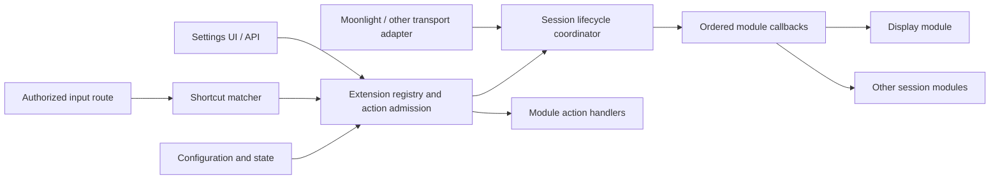

# Session extension API proposal

Status: revised design for review, 2026-10-30. No new runtime API or virtual-display
module is implemented by this document.

The goal is an SDK through which independently built modules can prepare a
session, react to streaming transitions, expose new settings, and offer actions
that users can invoke from a button, API, or keyboard shortcut. A virtual-display
module is the first consumer, not a special case in the framework.

Here, **pause means disconnecting while retaining the application/session for a
later resume**. It does not mean freezing a live media transport. Ending a stream
attempt, ending an application session, and removing a display are separate
operations. A shortcut may request any of those operations through its selected
action; their names and effects must be explicit.

## 1. Recommendation

Provide three composable contracts, implemented in managed libraries:

| Contract | Responsibility |
| --- | --- |
| Session lifecycle | Ordered preparation and release callbacks, authoritative state, resource ownership, and recovery. |
| Extension registry | Discoverable capabilities, settings descriptions, and named actions, bound to installed module identities. |
| Shortcut/action bridge | Match authorized input to an action without running native effects on the input thread. |

Reuse the existing broker, module loader, configuration store, and input SDK
direction. Do not introduce a second plugin loader, a second configuration
language, or an arbitrary callback in the shell. Display activation, native mode
setting, snapshots, platform helpers, and driver interaction belong to the
eventual display module.



The lifecycle coordinator serializes actions that affect an active session with
ordinary launch, disconnect, resume, and termination. The registry is discovery
and admission infrastructure; it does not become a display controller.

## 2. What exists and what must change

The source inspection used Amaterasu `6d490593192e944fd6f865a89c1ce0ed5d89bf4f`
and Vibeshine `3ed14cda3c5a6f622173200287faabe811cfedb1`. The Amaterasu working
tree also contained unrelated media changes, which this design does not alter.

- [The broker](../crates/runtime/src/broker/hooks.rs) already authorizes hook
  owners and participants, applies one absolute deadline, and collects ordered
  proposals. It currently lacks invocation cancellation, operation-ID lookup,
  durable receipts, and a cleanup mode that attempts every participant after
  another participant fails. It is a transport primitive, not the complete
  lifecycle API proposed here.
- [Registered APIs](../crates/runtime/src/broker/api.rs) already bind method
  schemas, callers, and providers to installed approvals. Current field schemas
  check top-level types; richer nested validation and action metadata are needed.
- [Configuration](../modules/configuration/README.md) already supports typed,
  bounded, nested fields, persisted revisions, and declarative migration. Its
  current namespace is the authenticated caller. It does not yet provide the
  extension discovery, scoped overlays, or generic management editor below.
- [NVHTTP launch](../modules/nvhttp/src/launch/workflow.rs) currently reacts to an
  ended RTSP stream by requesting launch cleanup, including the application.
  [Resume](../modules/nvhttp/src/launch.rs) currently handles live Desktop
  replacement. General retained-session pause/resume is an implementation task,
  not an existing behavior that can merely be renamed.
- [Stream-session](../modules/stream-session/src/pipeline/workflow.rs) already
  owns ordered provider cleanup. Its [journal](../modules/stream-session/src/pipeline/journal.rs)
  covers specific built-in resource identities. Extensible cleanup obligations
  need their own versioned records and provider recovery contract.
- [The input SDK proposal](input-plugin-sdk-proposal.md) defines synchronous
  `Pass`, `Replace`, and `Consume` with held-state ownership. It explicitly defers
  externally side-effecting actions. Section 9 supplies that separate interface;
  it does not silently give ordinary middleware permission to perform effects.

Vibeshine is a behavioral reference, not code to translate. Its local
`src/input.cpp::apply_shortcut` maps a chord to actions and its keyboard path
remembers press/release ownership. `src/nvhttp.cpp::terminate_all_streams_from_host`
drains streams and checks retained ownership before physical display recovery.
Its `resume` path validates the paired caller and rechecks retained output
readiness. These imply three requirements here: actions must be named and scoped,
display removal must follow capture retirement, and resume must revalidate
resources. Its global end-stream action is not the default authority of a remote
session shortcut.

## 3. Identity and compatibility

Use separate opaque identifiers:

| Identifier | Meaning |
| --- | --- |
| `host_epoch` | New random identity on coordinator restart; rejects stale process handles. |
| `session_id` | Logical application session, stable across disconnect/resume. |
| `stream_id` | One admitted streaming connection; new on reconnect/resume. A live reconfiguration keeps the ID and advances its generation. |
| `generation` | Monotonic fence for the identified session, stream, or resource, advanced before its reconfiguration or teardown. |
| `transition_id` | One admitted lifecycle operation, stable across retries. |
| `resource_id` | Provider-owned logical resource, distinct from an OS device path. |
| `incarnation` | Particular native realization of a resource; changes when its underlying display/producer is replaced. |
| `execution_domain` | Authorized desktop, compositor, seat, or runner context shared by launch/input/capture. |
| `mutation_domain` | Opaque provider-defined shared state affected by a transaction, such as a desktop topology. |
| `operation_id` | Idempotency key in a coordinator-issued caller epoch and sequence namespace. |

The broker supplies caller and initiator identity. Payload IDs select resources
only after authorization; they never confer ownership. Client identity is an
opaque paired-client reference, not a certificate, stream encryption key, or
network-supplied claim. Status and ordinary notifications omit secrets and raw
native handles.

A generation is always paired with a target kind and ID. Session termination
fences its child streams/resources; retiring one stream does not invalidate an
unrelated stream's identity. Reconciliation after host restart uses durable
logical resource identity and a fresh authorized permit, never an old epoch's
live handle.

Use namespaced capability, option, and action IDs such as
`example.virtual-display/remove-owned`. A module can add an option or action
without adding a variant to a central Rust enum. Common lifecycle events and
common schema types are versioned framework contracts. Plugin-specific payloads
use their own namespaced schemas.

The first control API is serialized data over the existing C-safe broker. Rust
SDK helpers wrap it; Rust objects, trait objects, closures, and allocation
ownership do not cross DLL boundaries. High-frequency input continues to use
the separately designed input ABI.

Public service surfaces proposed for version 1:

| Service | Operations | Result/authority |
| --- | --- | --- |
| `amaterasu.extension-registry/1` | `list`, `describe`, `capabilities` | Revisioned, paginated metadata filtered by caller authority. Native registration must match installed approval. |
| `amaterasu.session-lifecycle/1` | `prepare`, `start_stream`, `pause_stream`, `resume_stream`, `reconfigure_stream`, `validate_resources`, `end_session`, `snapshot`, `lookup` | Trusted transport adapters admit owner-bound transitions; plugins receive approved callbacks rather than impersonating an adapter. |
| `amaterasu.extension-actions/1` | `invoke`, `status`, `lookup`, `cancel` | Typed action receipt; immutable resolved target and caller/initiator scope. |
| Provider-owned registered API | `settings_get`, `settings_update`, `resource_plan`, `action_plan`, `action_execute`, `action_status`, `resource_reconcile`, and binding/snapshot methods where declared | Registry/coordinator delegates only to the selected, approved method/schema. A provider may implement a subset. |

These names identify selected services, not a requirement that their providers
share a binary. Session operations also require an idempotency key and expected
state/generation where applicable. A duplicate call returns its original receipt.
Snapshots expose desired, active, paused, retired, and recovery states separately from
queued work. `end_session` supersedes queued resume/reconfigure work, closes new
admission, and then drains in-flight work; it never waits behind an unlimited
queue of user actions.

Major versions identify incompatible protocols. Optional extensions are
advertised and negotiated before use. Resolve an exact approved method/schema
revision for each admitted operation; adding a field does not override current
strict parsers. Unknown required capabilities fail admission. Unknown optional
capabilities remain unavailable and visible in discovery. Never silently
substitute another provider after a side effect may have happened.

## 4. Lifecycle contract

There is one product lifecycle authority, independent of the transport. NVHTTP,
RTSP, and future transports translate their protocol into its operations. Native
plugins cannot publish an event to make the coordinator believe a stream started
or a session ended. Observers receive coordinator-issued facts.

### Phases and ordering

| Phase | Type | Meaning |
| --- | --- | --- |
| `session.prepare` | Blocking hook | After owner/app/settings resolution, before application launch. A module may allocate a session-scoped display here. |
| `stream.prepare` | Blocking hook | After final media negotiation, before capture/encoding activation; performs admitted provider preparation. Includes `initial`, `resume`, or `reconfigure` intent. |
| `stream.started` | Notification | Providers and media delivery are locally active. This is not proof of client playback. |
| `stream.reconfigured` | Notification | Consumers acknowledged a new effective plan and delivery resumed for the new generation. |
| `stream.quiescing` | Notification | New input/action admission for the retiring generation is closed; capture retirement is underway. |
| `stream.release` | Cleanup hook | Capture/native references to affected resources are confirmed retired. Reason is `pause`, `end`, `failed_start`, or `reconfigure`. |
| `session.paused` | Notification | No active stream remains, application is retained, and required pause cleanup is confirmed. |
| `session.resuming` | Notification | An authorized resume has a new stream identity and frozen settings snapshot. |
| `session.release` | Cleanup hook | Application termination and dependent stream retirement are confirmed; release session-scoped resources. |
| `session.retired` | Notification | Application/streams and their native references are retired; independently tracked restoration may still be deferred. |
| `session.ended` | Notification | All required cleanup/restoration obligations are confirmed complete. |
| `session.recovery_required` | Notification | An operation/effect cannot be confirmed; the affected resources remain fenced. |

`session.prepare` runs once per logical session, not on every resume.
`stream.prepare` runs on initial start, every resume, and each admitted live
reconfiguration after the relevant retirement barrier. The initial desired
mode is available at session preparation; the final negotiated mode is supplied
again before capture. A module must acknowledge or adjust to that final mode.
The core cannot freeze a capture output or issue an admission token and then
permit a later hook to replace it behind that token.

Disconnect retires that stream, runs `stream.release(reason=pause)`, and retains
the application if session policy allows it. Explicit termination runs stream
release when needed, terminates the application, then runs session release.
Ending an already paused session still runs session release exactly as an
idempotent logical operation. A failed launch runs the applicable cleanup hooks
even if neither a started nor a paused notification was ever emitted. A cleanup
that succeeds after a failed start ends with a failure reason; it does not turn
the failed launch into a successful one.

For multiple streams sharing a logical session, stream cleanup is per stream.
`session.paused` occurs only after the last stream retires. A provider cannot
remove a shared display while another stream owns a reference. Application/session expiry and provider-resource retention expiry are separate
deadlines. The former can end the session; the latter can release an idle display
while retaining the application, and resume may recreate it. Captures or other
borrowers prevent destructive expiry until their references retire.

Retaining a resource does not imply continuously enforcing its mode, HDR, or
exclusive topology while paused. Frozen policy independently selects keepalive,
resource expiry, and paused enforcement. The default is to preserve ownership
without fighting subsequent user display changes. Resuming revalidates what is
actually present and reapplies only the newly authorized plan.

### Hook input and result

A proposed hook request has this shape; names are illustrative wire contracts,
not currently accepted requests:

```json
{
  "phase": "stream.prepare",
  "version": 1,
  "transition_id": "transition-42",
  "host_epoch": "epoch-a",
  "session_id": "session-7",
  "stream_id": "stream-9",
  "generation": 3,
  "intent": "resume",
  "reason": null,
  "settings_revision": "snapshot-12",
  "requested_video": {
    "width": 2560,
    "height": 1440,
    "refresh_millihz": 120000,
    "hdr": true
  },
  "remaining_ms": 5000
}
```

App/client context and the participant's resolved settings accompany this
envelope only when approved. Refresh uses integer millihertz or an explicitly
negotiated rational representation, not a floating-point FPS comparison. Requested
and effective mode are separate; a module must report the actual selected mode.

Preparation returns either `prepared` with typed proposals and registered resource
obligations, or `rejected` with a bounded reason. `pending` means work has been
admitted and yields a receipt to poll; it is not permission to retry the effect.
Managed handlers must yield promptly and advance work through receipts/ticks or
module-owned workers. A blocking native operation cannot run in the input
callback or monopolize the host tick. Only declared proposal schemas are accepted.
For example, a selected display provider can propose a resource reference plus an exact capture binding. Other modules
cannot submit arbitrary patches to the launch JSON or silently rewrite its mode.

The coordinator validates all proposals and resolves dependencies before opening
capture. Install policy selects one owner per exclusive capability. A competing
capture-target proposal is an explicit conflict, not last-writer-wins. Modules
receive the approved plan revision when later phases need the selected target.

`prepared` describes a provider-ready candidate, not a bound capture consumer.
The preparation hook returns before capture opens. The coordinator then opens
consumers against that candidate under the pending generation and collects exact
binding acknowledgements. It commits the effective plan and activates delivery
and input only after all required acknowledgements succeed. A preparation hook
cannot wait for a consumer that the coordinator has not yet opened.

### Ordering, deadlines, and cleanup

Resolve a dependency DAG from installed policy and declared capabilities before
admission. Stable configuration order breaks ties among independent modules;
cycles or missing required participants reject preparation. Run independent
preparations serially in version 1; parallelization can be negotiated later.

Use one absolute operation deadline with bounded per-participant budgets. Reserve
cleanup capacity separately so an exhausted startup budget cannot prevent
rollback. Record an obligation **before** admitting any native mutation. A
participant that times out may already own resources and must be reconciled.

Cleanup traverses admitted obligations in reverse dependency order and attempts
independent cleanup even after one participant fails. A dependency whose consumer
still holds a native reference remains fenced until that reference retires.
The existing broker's stop-on-first-error hook loop cannot implement this policy
unchanged. Cleanup returns `released`, `pending`, or `unknown` for each obligation;
Only confirmed release/restoration permits a fully successful end. Keep two
independent status fields: runtime retirement and restoration. A known, retired
resource awaiting an absent monitor is `restoration_pending(resource_absent)`;
an in-flight or ambiguous native effect is `effect_unknown`. Both retain their
obligations, but only the latter requires fencing possible late effects. The
coordinator may emit `session.retired` after native consumers and the application
are gone, and emits `session.ended` only after required restoration is complete.
Explicitly approved deferral transfers the durable obligation to the recovery
owner; it does not erase it or report full restoration. Unrelated sessions need
not remain blocked when their mutation domains do not conflict.

Cleanup runs under the coordinator's explicit cleanup authority, independently
of an expired user request. Revoking a client closes its future action admission;
it must not revoke the coordinator's ability to release resources already owned
on that client's behalf. Restoration also checks ownership of the affected
topology, so it cannot overwrite a newer session's or the user's display changes.

Notification subscribers are best effort and cannot block state transitions.
They use bounded queues and revisioned snapshots to recover after missed events.
A module that must restore state registers a cleanup obligation; subscribing to
`session.ended` is too late to make restoration part of successful termination.

## 5. Resource planning, binding, and reconfiguration

### Plan before effects

Lifecycle preparation first asks the selected providers for a bounded, read-only
plan. That plan declares required capabilities, execution/device constraints,
logical resources to create or borrow, read/shared/exclusive access, shared
mutation domains, and the consumers that may need to retire. It also declares
whether consumers can apply the change live, need their local pipeline restarted,
or require protocol renegotiation/a new connection. This is provider planning,
not a plugin replacing arbitrary launch fields.

Check display, capture, encoder, input, and launch compatibility together before
admitting native effects. A virtual display that the selected capture provider
cannot target is an admission failure. Observations carry their revision,
execution domain, and completeness. Distinguish unknown observation, unsupported
capability, permission required, and usable capability; a missing permission is
not evidence that a platform lacks the feature. Permission acquisition itself
is an approved effect, never a side effect of registry discovery.

Some facts exist only after a compositor or monitor is created. Planning may
return an unresolved binding constrained to an approved resource/provider/domain.
After creation, resolve and validate it before app/capture use. Refinement outside
the approved constraints requires a new plan; a not-yet-known output ID is not a
reason to select an arbitrary current desktop.

The coordinator admits a plan only while its observed resource revisions and
borrower set are current. Acquire the necessary mutation rights in a documented
order, recheck revisions at the effect boundary, and reject stale plans without
effects. Adding or removing a display may affect a whole desktop topology, even
if the action names only one output. If another borrower cannot be safely
interrupted, return a conflict, defer, or preserve the existing shared mode with
an explicitly allowed effective-mode result. Do not silently broaden a remote
session's action into an interruption of other users' streams.

### Common binding contracts

Keep platform details behind selected providers while standardizing these
relationships:

| Contract | Required meaning |
| --- | --- |
| Resource reference | Provider identity, logical resource ID, native incarnation, revision, and execution/mutation domains. A reference is not permission to mutate. |
| Execution-domain binding | One authorized desktop/compositor/seat/runner context shared by application launch, capture, and input. Launch acknowledges it before starting the application. |
| Device-affinity constraint | A provider-issued device reference with known/unknown state and required/preferred policy. Display/capture/encoder selection agrees on compatibility or rejects; native LUIDs or DRM paths are not assumed portable. |
| Capture binding | Selected capture provider and selector schema, exact resource/incarnation, required effective mode, and permitted source/fallback policy. May refer to a compositor/producer output instead of an OS monitor. |
| Effective presentation plan | Actual display mode/orientation/scale, capture image dimensions/crop, delivered video dimensions, color state, and authoritative input-coordinate mapping, all tied to one plan revision. |
| Action effect plan | Expected revisions, affected resources/domains/borrowers, required rights, permitted degradation, consumer restart/renegotiation requirements, and cleanup obligations. |

Execution-domain providers can supply registered, bounded launch attachments:
environment values, existing socket/device references, and runner-specific
attachments. Each attachment schema names the consumer that validates it under
installed policy. Providers cannot inject arbitrary shell commands, rewrite a
user's executable, or install mounts/elevation by claiming a launch attachment.
The launch adapter must support and acknowledge the selected schema. A provider
may own a compositor/container without the generic host learning how to run it.

A retained application's execution-domain attachment remains a live dependency.
Resource expiry or replacement must preserve that attachment, obtain an explicit
supported application-reattachment acknowledgement, or report that application
restart is required. Recreating a compositor, socket, or runner does not reattach
an existing application. Resume rejects an incompatible replacement unless
session policy explicitly authorizes application restart. Recreating just an
output within a still-live compatible domain is a separate capability.

Input routing must acknowledge the same domain and geometry revision as capture.
Logical desktop coordinates, display pixels, and encoded video pixels can differ;
scaling or letterboxing never substitutes stream dimensions for native pointer
bounds. A missing/unsupported mapping disables that input capability or rejects
the plan when required. It must not silently target the host desktop.

Capture must acknowledge that it opened the exact resource incarnation, mode,
and geometry in the admitted plan. A provider's `created` or `enumerated` report
is insufficient. For an exact binding, missing/renamed outputs fail explicitly;
falling back to the first available monitor is prohibited. Retain the binding's
resource references until capture, held frames, GPU work, callbacks, and relevant
input state retire. Revalidate at startup and on provider invalidation; observation
cannot make hotplug and OS input atomically safe.

A shared producer has one owner and separately tracked consumer attachments.
Capability exclusivity applies within its resource/mutation domain, not to all
displays on the host. Multiple streams can consume one output with independent
video conversion policies when the selected providers support it. Detaching one
consumer cannot destroy the producer or reroute another consumer's input.

### Explicit reconfiguration and invalidation

`reconfigure_stream` accepts the current plan revision, target generation, desired
changes, and acceptable fallback policy. `set-mode`, output switching, and live
producer rebinding use this same operation through the action dispatcher:

1. Plan and authorize the full affected resource/borrower set. If the transport
   cannot express the new format, report `reconnect_required` before mutation.
2. Fence the retiring generation. Stop new input/capture work and retire affected
   consumers while retaining their resource obligations and prior plan.
3. Run release/preparation as required, with `intent=reconfigure`. Apply only the
   approved changes and validate the effective binding, video, and input plan.
4. Obtain acknowledgements from all affected consumers, publish the new plan
   revision, and resume work before emitting `stream.reconfigured`.
5. On failure, restore the prior plan only after its resources are revalidated.
   Otherwise leave the stream paused or in recovery with the application retained
   unless explicit session policy requires termination. Do not silently advertise
   the requested mode when continuing to scale a different actual mode.

A provider may submit `resource_invalidated` or request reconfiguration for its
own resource/incarnation when an output disappears, changes identity, or becomes
unusable. This is an authenticated report, not permission to publish a new
capture target or mutate shared topology. The coordinator verifies the report,
fences affected consumers, and admits a replacement plan. A revisioned resource
snapshot recovers missed invalidations; stale callbacks cannot overwrite the
new binding. Recovery fully internal to a provider is allowed only when it
preserves and revalidates the committed binding and consumer-visible contract.

This supports reconnect-free local pipeline restarts only when the selected
transport and every affected consumer advertise them. Version 1 can explicitly
reject unsupported live HDR/codec changes; naming a reconfiguration operation
does not assert that every backend can perform one.

### Resources outside an application session

`validate_resources` admits a scoped validation operation, with no application
or stream required. It can temporarily create/acquire a display for a headless
encoder probe, constrain that probe to a selected device, and return qualified
capability observations. It uses the same journal, resource rights, deadlines,
and cleanup/reconciliation receipts; all terminal probe paths release its
temporary obligations. Discovery itself remains read-only. Any retained host
resource needs an explicit separately owned policy lease, not a leaked probe.
Validation results identify what was tested: successful synthetic encoder
validation does not certify capture readiness.

## 6. Registration and discovery

An independently built module supplies a bounded descriptor containing:

- Stable module ID, descriptor/schema version, display name, and description.
- Provided and required capability IDs and compatible contract versions.
- Lifecycle participation, hook handler methods, and declared dependencies.
- Settings schema reference, schema version, and presentation metadata.
- Named action descriptors: argument/result schemas, allowed target scopes,
  required capability, execution class, and idempotency requirements.
- Optional suggested bindings, disabled until user or installed policy enables
  them; registration never grabs a key or installs a host-wide hook by itself.

The selected signed component set and local approvals bind the descriptor to the
actual provider. Runtime registration must agree with that selected identity and
approval. Changing a method, action authority, or required capability requires
matching local approval; metadata is not a way to mint privileges.

Schema references identify bundled or registry-approved schemas by namespace,
version, and digest; they are not arbitrary URLs fetched during registration.
Descriptions/labels are plain text, and editor hints cannot execute code. Action
availability conditions use a bounded declarative form over capability, session
state, and settings; the action provider must still revalidate when invoked.

A proposed `amaterasu.extension-registry/1` provides paginated `list`, `describe`,
and capability queries. Results distinguish installed, selected, enabled,
available, and effective. A registered Windows capability on Linux is not a
working capability. Discovery exposes the actual handler and schema revision
selected for this session, plus bounded unavailability reasons.

The first registry implementation can use existing `RegisterApi`/`CallApi`
approvals for provider endpoints. It must not auto-approve methods from a plugin
manifest. Web UI extensions remain separately signed and approved. Native modules
are trusted machine code; broker grants constrain API use, not native execution.

## 7. New settings without host edits

Extract the existing configuration field definitions/validation into a public
shared schema library. Use those same definitions for provider registration,
persistence, action argument validation where applicable, and the generic editor.
Do not maintain duplicate validators in the registry and UI.

An option has a stable local ID under its module namespace, schema definition,
label/help metadata, allowed scopes, apply policy, and optionally a capability
requirement. The framework supplies boolean, integer, decimal, string, enum,
list, and object editors. A keybinding is a standard structured value rendered
by a standard keybinding editor, not a hardcoded display-plugin setting.

For example, `example.virtual-display` can declare `enabled`, `mode_policy`,
`pause_retention_seconds`, and `remove_shortcut`. Their internal names and behavior
remain entirely module-owned. Adding a new display option uses its descriptor and
schema migration rather than a field in `HostSettings` or a new frontend switch.

Resolve only permitted scopes in this fixed order: module defaults, host/global,
application, paired client, then an explicitly authorized session override. The
descriptor can prohibit scopes for a particular option. Define absent as inherit;
`false`, zero, and an empty string are values. Null is accepted only when its schema
defines a distinct meaning. Return each effective value and its source scope.

Persist updates with a required expected revision. Validate the complete proposed
document and cross-field constraints before committing. Migrations explicitly
preserve, rename, remove, or replace fields; a plugin update cannot silently reset
user choices. Provider cross-field validation is a bounded read-only operation,
not a hook that applies settings before persistence succeeds.

Learned preferences and observed platform state occupy a separate provider-owned,
revisioned namespace from explicit settings. A provider may propose learning a
layout at an admitted boundary, but cannot overwrite a newer explicit user choice
or automatically turn every paused desktop edit into persistent configuration.
Use expected settings/observation revisions and report the source of a learned
default in effective-value provenance.

Apply policy is one of `next_session`, `next_stream`, or `live_action`. Preparation
uses a frozen, revisioned settings snapshot. Live changes affecting native
resources go through an action and a new lifecycle generation, not a configuration
callback mutating the current capture output. UI/status distinguish saved values
from the active snapshot and report pending application.

Other kinds of live settings may support a pure validation followed by an
explicit apply operation. The persisted revision and the applied revision remain
separate if application fails. Never roll back a newer persisted revision merely
because applying an older one failed.

Management delegates settings reads/updates to the selected provider under its
own validated caller namespace and the human's authorized role/scope. A browser
cannot select another module's raw storage key. Custom UI is optional; declared
schema and presentation metadata must be sufficient for basic configuration.

## 8. Named actions

Actions are typed operations, independent of their trigger. A button, authenticated
API request, lifecycle policy, or shortcut can invoke the same
`example.virtual-display/remove-owned` action through admission.

```json
{
  "action_id": "example.virtual-display/remove-owned",
  "operation_id": "actions-epoch-b:105",
  "target": {
    "host_epoch": "epoch-a",
    "session_id": "session-7",
    "expected_generation": 3
  },
  "arguments": {},
  "expected_settings_revision": "snapshot-12"
}
```

The dispatcher authenticates the caller, resolves the installed action version,
validates arguments and scope, and resolves the target before queueing work.
`current_session` in a binding is resolved to the input source's owned session at
the edge; delayed work never retargets to whichever session is current later.
Host-wide targets require a separately approved local/admin action. A remote
shortcut does not inherit that authority merely because it matches the same keys.

Each action declares `read_only`, `session_mutation`, or `host_mutation` execution.
Mutating actions first obtain the affected-resource plan in section 5 and enter
the appropriate lifecycle queue. They receive a
coordinator-issued target/permit for the admitted generation; the module cannot
upgrade a session mutation to a host mutation in its reply. Trusted native code
can still bypass its APIs, which is outside this API authorization guarantee.

Admission returns a stable receipt. Status distinguishes queued, running,
succeeded with confirmed effect, rejected before effect, cancelled before effect,
failed with cleanup complete, and recovery required. Accepted does not mean done.
An identical `(caller, operation_id, request)` resolves to the same receipt;
changed content conflicts. Bound receipt retention and report an expired/unknown
identity instead of executing it again. Durable effects require durable provider
reconciliation; broker in-memory deduplication alone is insufficient.

To make bounded retention enforceable, the coordinator issues an action epoch
to the authenticated caller and the SDK allocates monotonically increasing
submission sequences inside it. Admission retains a bounded result window and
a contiguous retired watermark; an older sequence returns `receipt_expired`,
never a new execution. Bound out-of-order admission and reject sequence jumps
outside that window. Closing an epoch prevents any later submission in it;
restart does not resurrect old epochs. The shortcut bridge records the mapping
from input edge identity to this operation ID before dispatch.

Cancelling a receipt closes further admission and requests cooperative retirement.
It cannot retract an OS call that already committed. The action/provider must
return confirmed compensation or retain a recovery obligation. Do not retry a
timed-out native effect under a new identity or invoke a fallback provider.

For a display-removal action during a stream, the lifecycle queue first fences new
capture/input, retires all consumers of that display, and confirms the affected
native references are gone. Only then may the selected owner remove its exact
display lease and optionally restore its recorded physical topology. The action
descriptor/policy specifies whether this pauses, reconfigures, or ends the
application session.
It does not implicitly kill the application or remove every virtual display.

## 9. Keyboard and other triggers

Version 1 supports a bounded chord: modifiers already held plus one fresh trigger
key-down, edge-triggered once until key-up. Use the input SDK's normalized key
identity with explicit physical/logical interpretation and left/right modifier
policy. Show unsupported combinations in the editor. Do not assume a Windows
virtual-key number has identical meaning in every provider/layout.

A binding declares source (`session_input` or separately authorized `host_local`),
target scope, action ID, validated arguments, enabled state, chord, and propagation
policy. Suggested chords are suggestions only. Reject ambiguous enabled bindings
for the same source/context unless explicit installed/user ordering resolves the
conflict. Discovery shows the effective binding and any registration conflict.

The input stage produces an **action intent**, not a native effect. Before
consuming a trigger it reserves intent/receipt capacity and records the trigger
edge's stable identity with the input disposition. The action bridge dispatches
that already-admitted intent outside the input callback. Duplicate packets and
auto-repeat reuse/suppress the same edge and never create extra removals.

This requires an explicit optional extension to the input middleware result:
an action intent and its propagation decision are admitted atomically with the
normal input receipt. Ordinary `Consume` continues to mean suppression only.
Unavailable action capacity rejects admission before invoking a stateful stage;
it cannot consume a key and silently drop its action. A crash between admission
and dispatch reconciles the admitted intent; it does not synthesize a new key-down.

For a consumed trigger, consume its matching release through the pinned ownership
record. Modifiers previously forwarded remain forwarded and must receive their
normal releases. Version 1 does not promise to hide the entire chord from the
game. Hiding modifiers requires separately designed bounded buffering and is not
simulated by swallowing their key-ups. Action failure never replays the original
key into the game. Input reset/disconnect releases held state without retriggering
actions; a recovered held-state snapshot is never a new shortcut press.

Remote input requires the existing authenticated session input lease and an
explicit action grant. Host-local global hotkeys use a separately selected
platform adapter. That adapter registers/unregisters only approved bindings,
reports OS conflicts, and retires callbacks on disable/unload. It does not install
an unrestricted keyboard logger. Timed sequences, macros, gamepad triggers, and
other source adapters can be later capabilities using the same action contract.

## 10. Virtual-display module example

This example exercises the contracts; it is not the implementation of the module.

| Capability | Example behavior |
| --- | --- |
| Session preparation | Journal an owned logical display and snapshot references before creating/activating it. |
| Stream preparation | Plan compatible requirements, apply authorized changes, and return a provider-ready candidate. The coordinator then opens consumers and commits only after exact binding acknowledgements. |
| Pause release | Release stream references; independently apply keepalive, resource-expiry, and paused-enforcement policies without implying application expiry. |
| Resume preparation | Revalidate or recreate the owned logical resource, advance native incarnation when replaced, and commit the new binding/geometry plan. |
| Live change or source loss | Request coordinator reconfiguration; fence the old binding, retire affected consumers, and prepare/confirm a compatible replacement without implicitly ending the application. |
| Session release | Remove owned resources and reconcile physical restoration; retain failed cleanup for recovery. |
| Settings | Publish standard schema/editors for activation, mode policy, retention, and the optional shortcut. |
| Actions | Publish `remove-owned`, `recreate-owned`, and `set-mode`, with separately declared target/effect policies. |

An example shortcut selects `remove-owned` for its own session. The generic
dispatcher handles authorization and the lifecycle queue. The display module
performs the platform-specific removal after capture retirement. The same action
appears as a UI button without adding a second removal implementation.

Resource recovery never relies solely on the last callback completing. Modules
journal native cleanup identity and ownership before effects, expose read-only
lookup/reconcile, and acknowledge released obligations explicitly. Startup must
resolve old ownership before allocating a conflicting replacement. An OS device
name changing across restart does not authorize adopting an unrelated monitor.

## 11. Failure, concurrency, and replacement rules

- Serialize mutations per logical session; additionally acquire declared shared
  resource ownership for effects spanning sessions. Use one documented lock/order
  policy. Do not hold registry/lifecycle locks while invoking plugin code.
- Each callback is tied to one admitted transition and generation. A late reply
  cannot publish an old capture target, reactivate a paused stream, or erase a
  newer cleanup obligation. Native effects are reconciled even when their reply
  is stale; discarding a reply is not undoing an effect.
- Input-triggered actions enqueue work. They cannot synchronously reenter the
  lifecycle coordinator from inside a hook or block on a lock held by their
  caller. Detect/reject dependency cycles rather than deadlocking.
- Resource providers support prepare/confirm-release/reconcile receipts.
  Transition cancellation waits for native retirement or reports unknown. It
  never treats broker request cancellation as proof of native cleanup.
- Disable first closes admission, retires bindings/callbacks, and drains owned
  state. Replacement/unload requires confirmed retirement of callbacks, worker
  threads, native references, and cleanup obligations. Version 1 may require
  idle/restart to activate an update; it must not promise seamless hot replacement.
- If a required provider disappears, mark its capabilities unavailable and retain
  affected obligations. Independent cleanup still runs. A process watchdog can
  contain a hung worker but cannot certify that a native OS effect was undone.
- Bounds are part of version 1: descriptor/page bytes, options/actions per module,
  queued intents, receipts, transitions, resource obligations, participants,
  callback deadlines, and notifications. Existing broker limits are upper bounds,
  not permission to allocate unbounded extension state. Proposed initial limits
  are 32 participants per transition, 16 queued actions per session, one executing
  session mutation per session, and 64 retained action receipts per caller epoch.
  Keep registry pages below 12 KiB and every broker envelope within its existing
  16 KiB limit; paginate metadata. Reserve a separate cleanup/control lane rather
  than sharing all admission capacity with user actions. Validate combined global
  budgets at startup and test exhaustion before effects. Increasing these limits
  requires qualification, not a wire-format change.

## 12. Implementation sequence and review gates

| Step | Deliverable | Evidence required before moving on |
| --- | --- | --- |
| 1. Public contracts | Shared schema extraction, extension descriptors, lifecycle envelopes/receipts, action/resource plans, exact capture and execution-domain bindings, SDK helpers. | Independent fixture compiled using only public SDK; version/schema/identity rejection tests. |
| 2. Broker gaps and registry | Cancellation/lookup semantics, bounded registration/discovery, approved action dispatch, revisioned status. | Lost admission/reply, duplicate/conflict, unauthorized provider/caller, expiry and capacity tests. |
| 3. Lifecycle integration | Transport-neutral session authority; launch/stream gates; retained pause/resume and reconfiguration; validation scopes, resource obligations and recovery. | Fake providers prove ordering, failed-start rollback, late-reply fencing, shared-topology conflicts, deferred restoration, domain/geometry consistency, and application retention. |
| 4. Settings and editor | Module-scoped persistence/overlays/migration, generic editor and effective-value provenance. | Add a fixture option without host-specific fields or frontend code; stale revisions and active/saved state tests. |
| 5. Shortcut bridge | Optional action-intent admission, press/release ownership, remote scope checks, host adapter boundary. | Duplicate/repeat, held modifiers, disconnect/reset, saturation, binding replacement, and stale-generation tests. |
| 6. First real module | Independently built virtual-display module using only public contracts; optional custom UI. | Source/tests plus real platform activation, mode change, disconnect, resume, shortcut removal, and restoration qualification. |

The first five steps are the generic API/framework. The sixth is the actual
display module requested as a later stage. Neither a schema nor a fake provider
is evidence of native display or real-client behavior. Implementation must run
focused Rust tests, rustfmt and Clippy; socket tests bind loopback by default.

The design is successful when a second independent module can add a setting,
participate in lifecycle transitions, and register a button/API/shortcut action
without editing a display-specific enum, the generic host shell, or its private
source. Full provider replacement remains possible; capability ownership and
public receipts must not depend on the built-in module being loaded.

The implementation tests must additionally cover the cases exposed by this
display review:

- A created display is not yet capture-visible, or the capture backend silently
  selects a different output. No delivery/input activation before an exact bind.
- A provider invalidation races an explicit resize, a disconnect, or a late old
  acknowledgement. One admitted plan wins; retired generations cannot reactivate.
- Display and encoder device constraints disagree, permission is unavailable,
  or the application cannot use the proposed execution domain. Reject before
  effects when discoverable; otherwise roll back the admitted preparation.
- A second stream borrows a topology resource during planning. Recheck the
  borrower set and reject/defer the now-conflicting mode change.
- Requested video size differs from the permitted shared display mode. Either
  acknowledge the permitted scale/input mapping consistently or reject it.
- A display-retention timer expires while the game still holds its compositor
  attachment. Preserve the live domain or report required application restart.
- An unplugged physical monitor defers known restoration after runtime retirement.
  Retain its obligation without classifying it as an unknown in-flight effect.
- A sessionless probe loses its reply after allocating a temporary display.
  Reconcile and release it without inventing an application session or replaying
  the native allocation.

## 13. Decisions for this review

1. Adopt retained-application disconnect semantics as the meaning of pause; keep
   the stream identity separate from the logical session.
2. Use ordered lifecycle hooks for required effects and revisioned notifications
   for observation; notifications never certify cleanup.
3. Make options and actions discoverable through namespaced descriptors, with
   explicit installed authority and shared schema validation.
4. Let shortcuts invoke the same typed actions as the UI/API through bounded
   intent admission. Keep native effects off the input callback.
5. Require exact capture binding and coordinator-owned reconfiguration; plan
   shared mutation domains before retiring affected consumers.
6. Keep execution-domain/device affinity, native incarnation, negotiated video,
   display mode, and input geometry consistent in one effective plan.
7. Keep provider/resource retention, paused enforcement, and application expiry
   separate; distinguish deferred restoration from unknown native effects.
8. Implement and qualify the framework before building the virtual-display module.

## 14. Display implementation review and revisions

Four Sol reviewers independently inspected Windows Vibeshine, Linux Vibeshine,
Rubylight, and the Wolf/Polaris/Sunshine architectures. The integrator checked
the findings against the proposal and local capture/input contracts. This is a
source-based design review, not implementation or hardware qualification.

| Pinned implementation | Source evidence | Contract requirement incorporated |
| --- | --- | --- |
| Vibeshine `3ed14cda3c5a6f622173200287faabe811cfedb1` | [Exact target lease and revalidation](https://github.com/Nonary/vibeshine/blob/3ed14cda3c5a6f622173200287faabe811cfedb1/src/display_target_lease.h#L115-L177); [startup temporary display probing](https://github.com/Nonary/vibeshine/blob/3ed14cda3c5a6f622173200287faabe811cfedb1/src/main.cpp#L849-L888); [shared topology and retained roles](https://github.com/Nonary/vibeshine/blob/3ed14cda3c5a6f622173200287faabe811cfedb1/src/remote_display_topology.h#L30-L71) | Exact consumer binding, validation-scoped temporary resources, selected-device constraints, shared mutation domains, and separate capture/retained ownership. |
| Rubylight `7a117b68319f0b73ca4fa96f235397071f1afe33` | [Output generation publication](https://github.com/RamazanKara/Rubylight/blob/7a117b68319f0b73ca4fa96f235397071f1afe33/rust/host/src/display_session.rs#L430-L453); [capture retirement and reopening](https://github.com/RamazanKara/Rubylight/blob/7a117b68319f0b73ca4fa96f235397071f1afe33/rust/host/src/stream.rs#L1306-L1407); [paused maintenance](https://github.com/RamazanKara/Rubylight/blob/7a117b68319f0b73ca4fa96f235397071f1afe33/rust/host/src/display_session.rs#L1345-L1399) | Provider-originated invalidation, coordinated replacement, and independent resource retention/enforcement. The actual generation change requires consumer action, not just a new output string. |
| Rubylight, same revision | [Shared physical mode policy](https://github.com/RamazanKara/Rubylight/blob/7a117b68319f0b73ca4fa96f235397071f1afe33/rust/windows/src/display/recovery.rs#L430-L446); [display mode versus scaling policy](https://github.com/RamazanKara/Rubylight/blob/7a117b68319f0b73ca4fa96f235397071f1afe33/rust/core/src/display_policy.rs#L65-L119); [learned preferences](https://github.com/RamazanKara/Rubylight/blob/7a117b68319f0b73ca4fa96f235397071f1afe33/rust/host/src/display_session.rs#L1992-L2098) | Explicit shared-state conflict outcomes; separate actual display/video/input geometry; provider-learned state must not overwrite explicit settings. |
| Wolf `9f439311dd7b93a5f35e14c578ff4385d666d758` | [Runner display/socket/device attachments](https://github.com/games-on-whales/wolf/blob/9f439311dd7b93a5f35e14c578ff4385d666d758/src/moonlight-server/sessions/common.cpp#L19-L54); [shared producer and input switching](https://github.com/games-on-whales/wolf/blob/9f439311dd7b93a5f35e14c578ff4385d666d758/src/moonlight-server/sessions/lobbies.cpp#L230-L243) | Execution-domain binding shared by launch, input, and capture; compositor/producer resources with separate consumer attachments. A monitor ID alone is insufficient. |
| Polaris `de8d152de13a7351f8e903a3a3d7dd11ac374b9e` | [Capture compatibility before display creation](https://github.com/papi-ux/polaris/blob/de8d152de13a7351f8e903a3a3d7dd11ac374b9e/src/platform/linux/virtual_display.cpp#L3065-L3147); [read-only capability observation](https://github.com/papi-ux/polaris/blob/de8d152de13a7351f8e903a3a3d7dd11ac374b9e/src/platform/linux/host_virtual_capture.h#L6-L35) | Plan compatible providers before effects; distinguish incomplete discovery, unsupported capture, and permission preparation. Capability queries do not authorize permission writes. |
| Sunshine `68f637a261abb2dd2f215e732d29a7de16de732a` | [Persisted pending restoration](https://github.com/LizardByte/Sunshine/blob/68f637a261abb2dd2f215e732d29a7de16de732a/src/display_device.cpp#L44-L102); [deferred restore scheduling](https://github.com/LizardByte/Sunshine/blob/68f637a261abb2dd2f215e732d29a7de16de732a/src/display_device.cpp#L795-L837) | Keep retired runtime, known deferred restoration, and unknown native effects separate. Restoring the currently available layout does not prove all saved outputs were restored. |

These implementations motivate the contracts; their internal APIs are not
reused or translated into Amaterasu. EDID contents, DPI policy, primary-display
placement, native mode enumeration, driver keepalive details, and OS recovery
algorithms remain provider-owned. The framework standardizes the relationships,
rights, binding acknowledgements, and outcomes needed to compose those providers.

The review exposed gaps in the initial proposal rather than a reason to move
display code into the shell. The required revisions are in sections 3–5 and 7:
explicit reconfiguration, effect planning, exact binding/invalidation, execution
domains, validation scopes, retention policy separation, and deferred restoration.
The existing cleanup authority, idempotent receipts, typed settings/actions, and
off-thread shortcut dispatch remain the foundation.

All four reviewers checked their findings' incorporation. That reread exposed a
preparation/consumer-acknowledgement ordering cycle and the missing dependency
between a retained application and its compositor. Both were corrected and
rechecked by the respective reviewers. No listed concern remains open in this
design review; concrete wire types, implementation tests, and platform behavior
remain future work.
